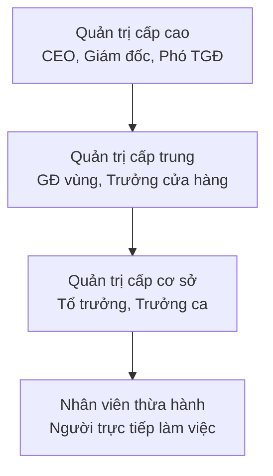
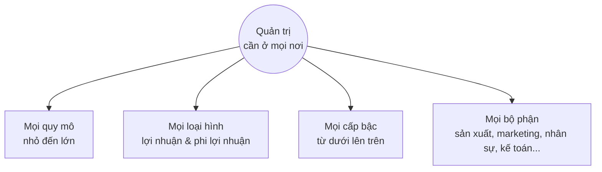

# Bài 1 — Nhà quản trị và bạn ở nơi làm việc
> Cách một nhóm người được điều phối quyết định rất nhiều đến việc nhóm đó thành công hay thất bại.

=== SECTION: Mở đầu: Vì sao một tổ chức có thể sụp đổ dù không ai phá nó? ===

Thử hình dung hai quán phở nằm cạnh nhau, cùng công thức, cùng giá, cùng lượng khách lúc mới mở. Một năm sau, quán thứ nhất mở thêm hai chi nhánh; quán thứ hai đóng cửa. Khác biệt có thể đến từ nhiều thứ: vị trí, vốn, cả may rủi. Nhưng một phần rất quan trọng thường không nằm ở nồi nước dùng, mà ở cách người chủ sắp xếp công việc, dùng người và giữ nhịp vận hành.

Hoặc hình dung một tiệm vật liệu xây dựng gia đình đã mở 25 năm. Mọi việc đều qua tay ông chủ: báo giá, duyệt đơn, giữ sổ, đòi nợ. Một ngày ông phải nằm viện hai tuần, và cả tiệm gần như đứng im: không ai dám báo giá, không ai dám duyệt đơn, khách quen bỏ sang chỗ khác. Tiệm không thua vì đối thủ. Tiệm yếu đi từ bên trong, vì chưa từng có ai được chuẩn bị để thay ông. Cuối bài, chúng ta sẽ quay lại chính tiệm này.

Thông điệp của bài học đầu tiên rất đơn giản: cách một nhóm người được điều phối quyết định rất nhiều đến việc nhóm đó thành công hay thất bại. Và đó chính là chuyện của quản trị.

> [!IMPORTANT] Bài này trả lời 6 câu hỏi
> 1. Nhà quản trị là ai, và họ làm việc ở đâu?
> 2. Tại sao tổ chức cần nhà quản trị?
> 3. Nhà quản trị thực sự làm những việc gì?
> 4. Điều gì đang làm thay đổi công việc của nhà quản trị hôm nay?
> 5. Muốn làm quản lý giỏi thì cần những kỹ năng nào?
> 6. Nếu tôi không định làm sếp, học quản trị có ích gì cho tôi?

## Một hiểu lầm cần bỏ ngay từ đầu

Nhiều người nghĩ: "Môn quản trị là dành cho người muốn làm sếp." Thực tế ngược lại. Ai đi làm cũng sẽ hoặc quản lý người khác, hoặc được người khác quản lý, và thường là cả hai. Hiểu quản trị giúp bạn làm việc khôn ngoan hơn ở bất kỳ vị trí nào, kể cả khi bạn là nhân viên mới, là người làm tự do hay đang tự kinh doanh nhỏ.

## Về cách tôi viết bài giảng này

Những gì trong bài đều dựa trên kiến thức quản trị học đã được nghiên cứu và kiểm chứng. Nhưng tôi chọn giảng theo cách của mình: bằng ví dụ đời thường và những điều tôi thấy trong thực tế đi làm, thay vì trích dẫn nghiên cứu. Mục tiêu là bạn hiểu và dùng được, không phải học thuộc.

Khi bài viết "thường thì" hay "nhiều nơi", hãy hiểu đó là xu hướng phổ biến, không phải quy luật tuyệt đối. Quản trị rất quan trọng, nhưng không phải mọi thành công hay thất bại của một tổ chức đều do quản trị.

## Bản đồ bài học: cái gì cần nắm chắc?

Bài 1 có khá nhiều ý. Để bạn không bị ngợp, tôi chia chúng làm ba tầng:

| Tầng | Nội dung | Bạn cần làm gì |
| --- | --- | --- |
| Cốt lõi | Nhà quản trị là ai; tổ chức là gì; vì sao cần nhà quản trị; hiệu suất và hiệu quả; bốn chức năng; ba nhóm kỹ năng | Hiểu chắc, giải thích được bằng lời của mình, nhận ra được trong đời thực |
| Nhận biết | Ba nhóm vai trò của nhà quản trị; những thay đổi đang diễn ra; tính phổ biến của quản trị | Nắm được ý chính, không cần nhớ chi tiết |
| Đọc thêm | Mô hình tự quản; danh sách 10 vai trò; học từ thất bại; chính trị công sở | Không bắt buộc, đọc khi bạn muốn đi xa hơn |

=== SECTION: Phần 1. Nhà quản trị là ai, và họ làm việc ở đâu? ===

## Định nghĩa: không phải ai có chức danh "trưởng" mới là nhà quản trị

Ngày trước, phân biệt rất dễ: nhà quản trị là người bảo người khác làm gì và làm thế nào. Ngày nay ranh giới mờ hơn nhiều. Một nhân viên bình thường có thể đang điều phối cả một dự án; ngược lại, có người mang chức danh quản lý nhưng chủ yếu vẫn tự làm chuyên môn.

Vì vậy, hãy nhớ định nghĩa theo việc người đó làm, chứ không theo chức danh:

> [!DEFINITION]
> Nhà quản trị là người điều phối và giám sát công việc của người khác để tổ chức đạt được mục tiêu.

Điểm mấu chốt ở đây là chữ "của người khác". Khi bước vào vai trò quản trị, thành công không còn chủ yếu nằm ở việc bản thân bạn làm tốt đến đâu, mà ngày càng nằm ở việc bạn giúp người khác và cả nhóm làm tốt đến đâu. Người đó có thể quản một phòng ban, một nhóm dự án gồm người từ nhiều bộ phận, hay chỉ một nhân viên duy nhất. Nhà quản trị vẫn có thể có phần việc chuyên môn riêng: một tổ trưởng kế toán vẫn tự làm sổ sách, song song với việc phân công và kiểm tra cho các bạn trong tổ.

Còn nhân viên thừa hành (không phải nhà quản trị) là người trực tiếp làm một công việc cụ thể và không có ai báo cáo cho mình.

## Ba cấp quản trị trong tổ chức truyền thống

Ở các tổ chức có cấu trúc truyền thống, ta hay hình dung một kim tự tháp: càng xuống dưới càng đông người.

| Cấp | Chức danh thường gặp | Việc chính |
| --- | --- | --- |
| Cấp cao | Tổng giám đốc, Giám đốc điều hành, Phó tổng giám đốc | Ra quyết định cho toàn tổ chức; đặt chiến lược và mục tiêu chung |
| Cấp trung | Giám đốc khu vực, Trưởng chi nhánh, Trưởng cửa hàng | Biến chiến lược của cấp trên thành hành động cụ thể |
| Cấp cơ sở | Tổ trưởng, Trưởng ca, Giám sát, Trưởng nhóm | Trực tiếp quản lý những người làm ra sản phẩm hoặc phục vụ khách hàng |

Một ví dụ gần gũi với chuỗi cà phê: chủ chuỗi quyết định năm tới mở thêm 10 cửa hàng ở miền Trung (cấp cao). Quản lý vùng chọn địa điểm, tuyển trưởng cửa hàng, phân bổ ngân sách (cấp trung). Trưởng ca ở mỗi cửa hàng xếp lịch cho nhân viên pha chế và xử lý khi khách phàn nàn (cấp cơ sở).

## Khi không còn "sếp": mô hình tự quản (đọc thêm)

Một số công ty thử bỏ hẳn các chức danh quản lý và chọn mô hình tự quản: các nhóm tự quyết định công việc của mình thay vì chờ cấp trên. Một hệ thống tự quản khá nổi tiếng có tên là holacracy. Ở đó, quyền ra quyết định được phân tán khỏi hệ thống cấp bậc truyền thống và giao cho các nhóm, các vai trò; mỗi người đảm nhận nhiều vai trò, và vai trò thay đổi theo từng dự án. Hôm nay bạn dẫn dắt dự án A, tuần sau bạn là thành viên bình thường trong dự án B.

Nhưng đừng vội kết luận rằng ở đó "không có quản trị". Việc điều phối vẫn phải có người làm, chỉ là người đó thay đổi liên tục và không mang chức danh. Quản trị là một chức năng, không phải một cái ghế.

## Nhà quản trị làm việc ở đâu? Trong các tổ chức

> [!DEFINITION]
> Tổ chức là một tập hợp người được sắp xếp có chủ đích để đạt một mục đích cụ thể.

Trường đại học là một tổ chức. Bệnh viện, câu lạc bộ bóng đá, một nhóm tình nguyện, một cửa hàng tạp hóa đầu ngõ, một ban tổ chức đám cưới cũng vậy. Dù to hay nhỏ, mọi tổ chức đều có ba đặc điểm chung:

1. Mục đích rõ ràng — thường được thể hiện qua các mục tiêu cần đạt. Một quán ăn muốn có lãi và giữ chân khách quen; một nhóm tình nguyện muốn quyên góp đủ sách cho một điểm trường.
2. Con người — cần có người thực hiện công việc thì mục tiêu mới thành hiện thực.
3. Cấu trúc có chủ đích — cách sắp xếp ai làm gì, ai báo cáo cho ai. Cấu trúc có thể rất linh hoạt (nhóm nhỏ lập ra để làm một dự án rồi giải tán), hoặc rất chặt chẽ (quân đội với hệ thống cấp bậc rõ ràng, có quy định, mô tả công việc cụ thể).

Ngày càng nhiều tổ chức chọn cách làm linh hoạt: làm theo nhóm, giao tiếp mở, làm ở đâu và lúc nào cũng được. Nhưng dù linh hoạt đến đâu, vẫn cần một cấu trúc nào đó để công việc chạy được, và vẫn cần người điều phối công việc đó.

> [!REFLECT] Câu hỏi nhanh cho bạn:
> Hãy nghĩ về một tổ chức bạn đang tham gia (lớp học, gia đình, nhóm bạn, nơi làm thêm). Mục đích của nó là gì? Ai là người đang "điều phối" — dù có chức danh hay không?

=== SECTION: Phần 2. Vì sao tổ chức cần nhà quản trị? ===

Có ba lý do, đi từ "bức tranh lớn" đến "con số cụ thể".

**Lý do 1 —** Thời thế càng bất ổn, càng cần người cầm lái. Nhân viên muốn làm việc linh hoạt hơn, kinh tế thế giới lên xuống khó đoán, công nghệ thay đổi từng tháng. Trong hoàn cảnh đó, phải có người nhận ra vấn đề nào là quan trọng nhất và đưa ra cách đối phó. Đó là việc của nhà quản trị.

**Lý do 2 —** Không có họ, việc khó mà chạy. Nhà quản trị tạo ra môi trường và quy trình để người khác làm được việc. Khi việc bị tắc hoặc làm sai, họ là người tìm ra nguyên nhân và đưa mọi thứ về đúng hướng. Giống như nhạc trưởng: không trực tiếp chơi nhạc cụ nào, nhưng thiếu họ thì dàn nhạc dễ thành một mớ âm thanh hỗn độn.

**Lý do 3 —** Họ tạo ra khác biệt về kết quả. Người quản lý trực tiếp có ảnh hưởng rất lớn đến trải nghiệm, sự gắn bó và kết quả làm việc của nhân viên. Họ ảnh hưởng đến việc ứng viên có nhận lời mời làm việc hay không, nhân viên gắn bó đến đâu, cố gắng đến đâu, và có ở lại hay nghỉ việc.

Có một câu nói quen thuộc trong giới nhân sự: "Người ta gia nhập một công ty, nhưng rời bỏ một người sếp." Đó không phải quy luật, nhưng ai đi làm vài năm cũng sẽ thấy nó đúng khá thường xuyên. Những hành vi của từng nhân viên (gắn bó hay không, cố gắng hay không) cộng dồn lại thành thành công hay thất bại của cả tổ chức.

> [!REFLECT] Liên hệ bản thân:
> Bạn đã bao giờ làm ở một nơi mà công việc không tệ, nhưng bạn vẫn muốn nghỉ vì người quản lý? Hoặc ngược lại, một nơi lương không cao nhưng bạn ở lại vì người dẫn dắt mình? Đó chính là lý do 3 trong đời thực.

=== SECTION: Phần 3. Quản trị là gì, và nhà quản trị thực sự làm gì? ===

## Định nghĩa quản trị

> [!DEFINITION]
> Quản trị là quá trình điều phối và giám sát công việc của người khác để công việc đó được hoàn thành một cách hiệu suất và hiệu quả.

Nhà quản trị là người; quản trị là việc họ làm. Hai chữ quan trọng nhất trong định nghĩa trên là "hiệu suất" và "hiệu quả". Người học hay nhầm hai khái niệm này, nên ta dừng lại kỹ.

## Hiệu suất và hiệu quả: làm đúng cách và làm đúng việc

|  | Hiệu suất (Efficiency) | Hiệu quả (Effectiveness) |
| --- | --- | --- |
| Câu hỏi đặt ra | Có lãng phí nguồn lực không? | Có đạt được mục tiêu không? |
| Câu dễ nhớ | Làm việc đúng cách | Làm đúng việc |
| Quan tâm đến | Phương tiện — tiền, thời gian, con người, máy móc bỏ ra | Kết quả — mục tiêu cuối cùng |
| Ví dụ khách sạn | Gom toàn bộ đặt phòng và mua sắm về một trung tâm chung để giảm chi phí | Ghi nhớ sở thích của khách quen để lần sau phục vụ đúng ý, khiến khách quay lại |

Hãy xem một ví dụ. Hai nhóm trong một văn phòng cùng xử lý 50 hồ sơ vay vốn. Nhóm A xong trong 2 giờ, nhóm B mất 5 giờ: cùng một kết quả nhưng A tốn ít thời gian hơn, nên A hiệu suất cao hơn.

Nhưng giả sử mục tiêu thật của tuần là duyệt kịp 10 hồ sơ khẩn sắp hết hạn, còn 50 hồ sơ kia đều chưa gấp. Khi đó cả hai nhóm đều không hiệu quả: làm nhanh hay chậm thì mục tiêu vẫn không đạt.

Một tổ chức tốt cần cả hai. Hiệu suất mà thiếu hiệu quả là chạy rất nhanh nhưng sai đường. Hiệu quả mà thiếu hiệu suất là đến được đích nhưng tốn gấp ba xăng. Nhà quản trị giỏi luôn hướng tới: ít lãng phí nhất, đạt mục tiêu cao nhất.

> [!NOTE] Lưu ý về từ ngữ:
> Các giáo trình tiếng Việt không dùng từ thống nhất. Có tài liệu gọi efficiency là "hiệu quả", và gọi effectiveness là "hiệu lực" hay "kết quả". Khi đọc tài liệu khác, đừng bám vào chữ tiếng Việt; hãy bám vào nghĩa: một bên là tốn ít nguồn lực, một bên là đạt đúng mục tiêu.

## Bốn chức năng quản trị

Đầu thế kỷ 20, một nhà quản lý người Pháp tên Henri Fayol cho rằng mọi nhà quản trị đều làm năm việc: lập kế hoạch, tổ chức, chỉ huy, phối hợp và kiểm soát. Ngày nay, người ta rút gọn lại thành bốn chức năng — cách mô tả công việc quản trị phổ biến nhất hiện nay.

**1. Hoạch định (Planning) —** Đặt mục tiêu, chọn chiến lược để đạt mục tiêu, và lập kế hoạch để phối hợp các hoạt động. Nếu bạn không định đi đâu thì đường nào cũng được. Nhưng khi đã có đích đến, bạn phải tính đường đi tốt nhất. Tổ chức nào cũng tồn tại vì một mục đích, và nhà quản trị là người xác định mục đích đó cùng con đường đi tới.

**2. Tổ chức (Organizing) —** Sắp xếp và phân chia công việc. Cụ thể: cần làm những việc gì, ai làm, các việc được gom thành nhóm ra sao, ai báo cáo cho ai, và quyết định được đưa ra ở đâu.

**3. Lãnh đạo (Leading) —** Làm việc cùng và thông qua con người. Khi nhà quản trị động viên nhân viên, hòa giải mâu thuẫn trong nhóm, tác động đến suy nghĩ và hành động của người khác, chọn cách truyền đạt thông tin phù hợp, là họ đang lãnh đạo. Hình ảnh một trưởng cửa hàng tập hợp cả đội đầu ca, nhắc mục tiêu doanh số và cổ vũ tinh thần trước giờ mở cửa là ví dụ điển hình.

**4. Kiểm soát (Controlling) —** Theo dõi, so sánh và điều chỉnh. Sau khi đã có kế hoạch, đã phân công, đã động viên, nhà quản trị cần kiểm tra xem mọi việc có đi đúng hướng không. Kết quả thực tế được đem so với mục tiêu. Nếu lệch, nhà quản trị phải đưa công việc về đúng quỹ đạo.

> [!EXAMPLE] Ví dụ tổng hợp — tổ chức một buổi liên hoan cuối năm cho lớp:
> - Hoạch định: Mục tiêu là 40 người tham dự, ngân sách 8 triệu, tổ chức vào tối thứ Bảy cuối tháng 12.
> - Tổ chức: Chia ban: ban địa điểm, ban văn nghệ, ban hậu cần, ban thu chi; mỗi ban có một trưởng ban.
> - Lãnh đạo: Nhắc nhở, động viên các ban; giải quyết khi hai bạn cãi nhau về chọn nhà hàng.
> - Kiểm soát: Một tuần trước ngày diễn ra, kiểm tra đã thu đủ tiền chưa, đã đặt chỗ chưa; thiếu thì xử lý ngay.

> [!WARNING] Lưu ý quan trọng:
> Bốn chức năng này không nhất thiết diễn ra theo đúng thứ tự 1-2-3-4. Trong thực tế, nhà quản trị có thể đang kiểm soát việc này thì phải lập kế hoạch cho việc khác, xen lẫn với động viên nhân viên. Nhưng dù thứ tự thế nào, nhà quản trị nào cũng làm đủ cả bốn.

## Các vai trò của nhà quản trị (Mintzberg)

Bốn chức năng trả lời câu hỏi "nhà quản trị làm những loại việc gì?". Nhưng nhà nghiên cứu Henry Mintzberg muốn biết họ thực sự làm gì trong một ngày, nên ông đi theo quan sát các nhà quản lý ngoài đời. Ông thấy công việc quản trị có thể mô tả qua các vai trò, tức những kiểu hành động mà người ta trông đợi ở một nhà quản trị. Các vai trò này gom thành 3 nhóm, và đây là phần bạn cần nắm:

| Nhóm vai trò | Hiểu đơn giản | Ví dụ ở một chuỗi cà phê |
| --- | --- | --- |
| Con người | Làm việc với người trong và ngoài tổ chức, kể cả những việc mang tính nghi thức | Kèm nhân viên mới; dự lễ khai trương chi nhánh; giữ quan hệ với chủ mặt bằng |
| Thông tin | Thu thập thông tin, truyền tin trong nội bộ, phát ngôn ra bên ngoài | Xem báo cáo doanh thu; họp đầu tuần báo tin cho nhân viên; trả lời báo chí |
| Quyết định | Đưa ra lựa chọn và giải quyết vấn đề | Quyết định ra món mới; xử lý khi máy pha hỏng; chia ngân sách; thương lượng giá cà phê hạt |

> [!TIP] Mẹo nhớ:
> nhà quản trị làm việc với người, với tin, và ra quyết định.

Nhà quản trị ở mọi loại tổ chức và mọi cấp đều đóng cả ba nhóm vai trò này, nhưng mức độ nặng nhẹ khác nhau theo cấp bậc. Càng lên cao, những việc như đại diện cho tổ chức, phát ngôn, giữ quan hệ bên ngoài và đàm phán càng chiếm nhiều thời gian. Ở cấp cơ sở, việc trực tiếp hướng dẫn, động viên nhân viên lại quan trọng hơn.

### Đọc thêm: 10 vai trò cụ thể.

Nếu muốn đi sâu, đây là 10 vai trò Mintzberg tìm ra. Bạn không cần thuộc bảng này; chỉ cần nhận ra chúng khi gặp.

| Nhóm | Vai trò | Hiểu đơn giản | Ví dụ |
| --- | --- | --- | --- |
| Con người | Người đại diện | Có mặt trong các dịp mang tính nghi thức, thay mặt tổ chức | Cắt băng khai trương, ký giấy khen, dự đám cưới nhân viên |
|  | Người lãnh đạo | Tuyển dụng, đào tạo, động viên nhân viên | Kèm cặp nhân viên mới trong tuần đầu |
|  | Người liên lạc | Giữ quan hệ với người bên ngoài nhóm | Giữ mối quan hệ với đối tác, với các phòng ban khác |
| Thông tin | Người thu thập thông tin | Nắm bắt thông tin trong và ngoài tổ chức | Đọc báo cáo, theo dõi đối thủ, nắm tâm tư nhân viên |
|  | Người truyền tin nội bộ | Chuyển thông tin đến người trong tổ chức | Họp đầu tuần, gửi thông báo nội bộ |
|  | Người phát ngôn | Nói thay tổ chức với bên ngoài | Trả lời báo chí, trình bày với nhà đầu tư |
| Quyết định | Người khởi xướng | Tìm cơ hội, bắt đầu thay đổi | Đề xuất mở dòng sản phẩm mới |
|  | Người xử lý sự cố | Giải quyết khi có chuyện bất ngờ | Nhà cung cấp giao trễ, khách phàn nàn trên mạng xã hội |
|  | Người phân bổ nguồn lực | Quyết định ai được bao nhiêu tiền, người, thời gian | Chia ngân sách quý cho các nhóm |
|  | Người đàm phán | Thương lượng để đạt thỏa thuận | Đàm phán giá với nhà cung cấp, thỏa thuận lương |

## Vậy nên dùng cách nhìn nào?

Cả hai đều hữu ích và bổ sung cho nhau:

- Bốn chức năng là cách mô tả được dùng phổ biến nhất, vì nó gọn và dễ xếp hàng nghìn hoạt động khác nhau vào bốn "ngăn kéo" rõ ràng.
- Các vai trò cho ta thấy chi tiết hơn nhà quản trị làm gì bên trong từng chức năng. Ví dụ, khi làm chức năng kiểm soát, nhà quản trị thường đóng vai người thu thập thông tin và người xử lý sự cố.

> [!REFLECT] Thử sức:
> Hãy nhớ lại một ngày làm việc của một người quản lý bạn biết. Họ đã đóng những vai trò nào, thuộc nhóm nào: con người, thông tin hay quyết định?

=== SECTION: Phần 4. Điều gì đang thay đổi công việc của nhà quản trị? ===

Hãy bắt đầu bằng một cửa hàng quần áo nhỏ, bán cả ở tiệm lẫn trên mạng.

Vài năm trước, chị chủ quản lý bằng cách đứng ở tiệm cả ngày: nhìn nhân viên bán hàng, đếm hàng, cuối ngày chốt sổ. Bây giờ, hai bạn trả lời tin nhắn khách làm việc ở nhà. Đơn hàng được giao bởi các shipper không phải nhân viên của chị. Chị xem doanh thu trên phần mềm, dùng AI soạn bài đăng bán hàng. Còn nhân viên thì than mệt, vì tin nhắn khách đến cả lúc nửa đêm.

Không có gì trong câu chuyện này là lạ. Nhưng nó cho thấy ba thay đổi lớn mà người quản lý hôm nay phải đối mặt.

## Thay đổi 1: Không còn nhìn thấy nhân viên làm việc

- Làm việc từ xa (remote): làm việc ở ngoài nơi làm việc của công ty, ví dụ ở nhà.
- Làm việc kết hợp (hybrid): vừa làm từ xa, vừa đến công ty, ví dụ 3 ngày ở văn phòng, 2 ngày ở nhà.

Sau đại dịch, nhiều nơi nhận ra có những việc làm ở đâu cũng được. Người lao động thích sự linh hoạt này vì nó giúp họ cân bằng công việc và cuộc sống. Với nhiều loại việc, làm từ xa vẫn cho kết quả tốt, có khi còn tốt hơn; với loại việc khác thì không.

Điều này đòi hỏi gì ở người quản lý? Chị chủ cửa hàng không thể ngồi cạnh bạn nhân viên đang trả lời tin nhắn ở nhà. Chị phải chuyển từ quản lý quá trình ("bạn có đang ngồi làm không?") sang quản lý kết quả ("khách có được trả lời nhanh không, đơn có chốt được không, khách có quay lại không?"). Nhưng chỉ nhìn con số cũng có cái bẫy riêng, bạn sẽ gặp lại chuyện này ở Câu 9 trong phần câu hỏi.

## Thay đổi 2: Công nghệ, AI và người làm tự do

Chuyển đổi số không có nghĩa là mua phần mềm mới, mà là nghĩ lại cách làm việc. Chuyển từ ghi sổ tay sang phần mềm bán hàng mới chỉ là thay công cụ. Dùng dữ liệu từ phần mềm để biết mặt hàng nào bán chạy vào giờ nào, rồi sắp xếp lại ca làm và cách nhập hàng: đó mới là chuyển đổi số.

**Trí tuệ nhân tạo (AI)** là các hệ thống máy tính được làm ra để thực hiện những việc thường cần đến trí óc con người: nhận biết, suy luận, dự đoán, viết nội dung, hay ra quyết định. AI có thể hỗ trợ con người, hoặc tự làm thay một phần công việc: trả lời tin nhắn khách lúc nửa đêm, gợi ý nên nhập hàng gì, soạn nháp một bài đăng.

Theo kinh nghiệm của tôi, AI hữu ích nhất khi người và máy làm cùng nhau: máy làm nhanh phần lặp lại, người kiểm tra và quyết định. Một người nhập hàng có thể dùng dữ liệu để biết mẫu nào sẽ bán chạy, nhưng vẫn phải tự tay sờ vải, thử độ vừa trước khi nhập.

**Kinh tế gig (gig economy)**, hay thị trường lao động làm tự do theo từng việc, là khi người lao động nhận việc theo từng đơn, từng lần, thay vì làm nhân viên chính thức. Shipper, tài xế xe công nghệ, cộng tác viên bán hàng online là những ví dụ quen thuộc. Nhiều người chạy cho vài nơi cùng lúc để đủ thu nhập. Với người quản lý, điều này đặt ra câu hỏi mới: không ép được lịch làm thì sắp xếp thế nào, giữ chất lượng bằng cách nào, và có trách nhiệm gì với sự an toàn của họ. Lưu ý: đừng nhầm kinh tế gig với "kinh tế thị trường tự do", đó là một khái niệm khác hẳn.

## Thay đổi 3: Chăm lo cho con người một cách toàn diện hơn

**Sự khỏe mạnh toàn diện của người lao động (employee well-being)** là khi một người thấy cuộc sống của mình tích cực và cảm thấy ổn. Nó rộng hơn "vui vẻ" hay "sức khỏe tinh thần": nó gồm nhiều mặt, trong đó có cả sức khỏe thể chất lẫn tinh thần.

Người lao động hôm nay, nhất là người trẻ, mong đợi nhiều hơn một chỗ làm có lương: họ muốn không bị vắt kiệt, muốn được đối xử tử tế. Và ai đi làm cũng thấy: rất nhiều khi, nguồn căng thẳng lớn nhất không phải là công việc, mà là cách người quản lý đối xử với mình. Người ít căng thẳng thì thường làm việc tốt hơn.

Vì vậy người quản lý ngày nay cần thêm kỹ năng kèm cặp (coaching) và hỗ trợ cảm xúc. Những việc rất cụ thể: không nhắn việc lúc 11 giờ đêm nếu không gấp, nhận ra khi một bạn đang quá tải, hỏi han khi thấy ai đó khác thường.

Một phần khác là sự công bằng và hòa nhập: người thuộc mọi vùng miền, giới tính, độ tuổi, hoàn cảnh đều được đối xử công bằng và thấy mình thuộc về. Ở nơi làm việc, điều này có thể rất cụ thể: không đùa cợt giọng nói vùng miền, không chỉ giao việc hay cho người thân quen với sếp, không coi nhẹ ý kiến của người trẻ hay người lớn tuổi. Lợi ích không chỉ là giữ được người giỏi, mà còn là có nhiều ý tưởng hơn và hiểu khách hàng hơn, vì khách hàng của bạn cũng đa dạng như vậy.

> [!REFLECT] Liên hệ bản thân:
> Nếu bạn từng làm thêm ở quán cà phê, shop hay chạy giao hàng: bạn đã gặp thay đổi nào trong ba thay đổi này? Người quản lý của bạn xử lý nó tốt hay chưa?

=== SECTION: Phần 5. Nghề quản trị và những kỹ năng cần có ===

## Nghề quản trị có tương lai không?

Nhìn chung là có. Tổ chức càng phức tạp thì càng cần người biết điều phối, nên các vai trò quản lý vẫn tiếp tục cần thiết. Tuy nhiên, triển vọng cụ thể khác nhau theo ngành và theo thị trường lao động từng nơi; nếu cần con số, hãy tra các báo cáo thị trường lao động mới nhất.

Phần thưởng của vai trò quản lý không chỉ là thu nhập. Làm quản lý, bạn được:

- tạo ra một môi trường nơi mọi người phát huy hết khả năng;
- giúp người khác tìm thấy ý nghĩa trong công việc; kèm cặp, nâng đỡ họ;
- suy nghĩ sáng tạo, gặp gỡ nhiều người trong và ngoài tổ chức;
- được ghi nhận, có vị thế và có ảnh hưởng thực sự đến kết quả chung.

## Cái bẫy thăng chức: giỏi chuyên môn chưa chắc giỏi quản lý

Chúng ta đều từng nghe về một "người sếp tồi" — hoặc khiến công việc thành cực hình, hoặc chẳng biết nhân viên mình đang làm gì. Chuyện này thường xảy ra vì tổ chức thăng chức người giỏi chuyên môn mà không kiểm tra hay đào tạo kỹ năng quản lý.

Một nghiên cứu về nhân viên bán hàng cho thấy điều đáng suy nghĩ: người có doanh số cao nhất thường là người được đề bạt làm quản lý. Nhưng trong nghiên cứu đó, doanh số cao khi còn là nhân viên không dự báo được thành tích tốt khi làm quản lý; thậm chí hai yếu tố này còn có tương quan âm. Đừng biến kết quả này thành quy luật "người bán giỏi nhất sẽ là sếp tệ nhất" — bài học thực sự là bán hàng và quản lý người bán hàng là hai bộ kỹ năng khác nhau.

Những tổ chức hiểu điều này sẽ đào tạo bài bản cho quản lý mới. Chẳng hạn, có công ty giao vận lớn cho các giám sát tuyến mới lên chức tham gia khóa huấn luyện tám ngày tập trung về quản lý con người, quản lý thời gian, giao tiếp và tuân thủ an toàn lao động.

## Ba nhóm kỹ năng của nhà quản trị (Katz)

Nhà nghiên cứu Robert Katz cho rằng nhà quản trị cần ba nhóm kỹ năng:

1. **Kỹ năng chuyên môn (kỹ thuật) —** kiến thức và kỹ thuật đặc thù của một công việc cụ thể. Ví dụ: kế toán biết lập báo cáo tài chính, bếp trưởng biết nấu, trưởng nhóm lập trình biết viết mã. Kỹ năng này quan trọng nhất với quản lý cấp cơ sở, vì họ trực tiếp quản lý người làm chuyên môn và thường được thăng chức nhờ giỏi chuyên môn.
2. **Kỹ năng quan hệ con người —** khả năng làm việc tốt với người khác, cả từng người lẫn cả nhóm: giao tiếp, động viên, dẫn dắt, tạo dựng niềm tin. Vì nhà quản trị nào cũng làm việc với con người, kỹ năng này quan trọng như nhau ở mọi cấp.
3. **Kỹ năng tư duy (nhận thức) —** khả năng suy nghĩ về những tình huống trừu tượng và phức tạp. Người có kỹ năng này nhìn tổ chức như một tổng thể, hiểu các bộ phận liên quan với nhau thế nào, và thấy tổ chức đứng ở đâu trong môi trường rộng lớn hơn. Kỹ năng này càng lên cao càng quan trọng.

| Cấp quản trị | Kỹ năng tư duy | Kỹ năng quan hệ con người | Kỹ năng chuyên môn |
| --- | --- | --- | --- |
| Cấp cao | Rất cần | Cần như mọi cấp | Ít cần hơn |
| Cấp trung | Cần vừa | Cần như mọi cấp | Cần vừa |
| Cấp cơ sở | Ít cần hơn | Cần như mọi cấp | Rất cần |

> [!TIP] Một hình ảnh dễ nhớ:
> Một đầu bếp giỏi được lên làm bếp trưởng thì vẫn cần tay nghề nấu (chuyên môn), nhưng giờ phải biết điều phối đội bếp (con người). Nếu sau này làm giám đốc cả chuỗi nhà hàng, người đó ít khi cầm chảo, mà dành phần lớn thời gian nghĩ về thực đơn cho từng thị trường, chiến lược mở rộng, đối thủ cạnh tranh (tư duy).

Bên trong ba nhóm lớn này, bối cảnh mới đòi hỏi thêm những kỹ năng cụ thể. Nổi bật nhất hiện nay là sự thấu cảm — khả năng hiểu cảm xúc của người khác và phản hồi bằng sự quan tâm. Người lao động luôn mang theo nhiều điều mà ta không nhìn thấy trên bề mặt, nhất là khi làm từ xa và khi áp lực tinh thần ngày càng lớn.

Một biểu hiện rất cụ thể của kỹ năng con người là trò chuyện với nhân viên về con đường nghề nghiệp của họ: họ đang làm tốt đến đâu, cần học thêm gì, phía trước có cơ hội nào. Trong thực tế, rất nhiều người quản lý hiếm khi làm việc này, trong khi phần lớn nhân viên, nhất là người trẻ, rất muốn có. Chỉ cần khoảng 30 phút, vài tháng một lần, nhưng nó ảnh hưởng không nhỏ đến việc nhân viên có ở lại hay không.

=== SECTION: Phần 6. Không định làm sếp, có cần học quản trị không? ===

Câu trả lời là có, vì ba lý do.

## Lý do 1: Quản trị có mặt ở khắp nơi

Quản trị cần thiết trong mọi loại hình, mọi quy mô, mọi cấp độ, mọi bộ phận và mọi quốc gia. Người ta gọi đây là tính phổ biến của quản trị.

Điều đó không có nghĩa là ở đâu quản trị cũng giống hệt nhau. Một trưởng nhóm kiểm thử phần mềm và tổng giám đốc của chính công ty đó đều hoạch định, tổ chức, lãnh đạo và kiểm soát. Khác biệt chỉ nằm ở mức độ và trọng tâm, không phải ở bản chất công việc.

Tổ chức được quản lý tốt thì giữ được khách hàng, phát triển và vững vàng ngay cả khi khó khăn. Tổ chức quản lý kém thì mất dần khách và doanh thu. Học quản trị giúp bạn nhận ra khi nào một tổ chức đang bị quản lý kém và biết cách góp phần sửa nó.

## Lý do 2: Hoặc bạn quản lý, hoặc bạn được quản lý

Sau khi ra trường và đi làm, hầu hết chúng ta sẽ ở một trong hai vị trí — hoặc cả hai. Nếu bạn muốn làm quản lý, môn học này là nền móng. Nếu không, bạn vẫn phải làm việc với người quản lý mỗi ngày. Hiểu quản trị giúp bạn hiểu vì sao sếp mình hành xử như vậy và tổ chức của mình vận hành ra sao.

## Lý do 3: Hiểu cách nhà quản trị nghĩ giúp bạn làm việc tốt hơn

Bạn muốn làm kế toán, lập trình viên, nhà thiết kế hay nghiên cứu thị trường? Hiểu cách nhà quản trị suy nghĩ vẫn giúp bạn đạt kết quả tốt hơn và tiến xa hơn. Và biết đâu, bạn sẽ làm quản lý lúc nào không hay. Một người bắt đầu là kiểm toán viên, vài năm sau có thể đang dẫn dắt cả một nhóm kiểm toán. Một lập trình viên giỏi rồi cũng sẽ được giao làm trưởng nhóm.

Ngay cả khi làm việc độc lập, như làm tự do hay kinh doanh một mình, bạn vẫn dùng rất nhiều tư duy và kỹ năng của quản trị: hoạch định công việc, phân bổ thời gian và tiền bạc, kiểm soát kết quả. Và khi công việc lớn đến mức cần thêm người, bạn sẽ chính thức bước vào vai trò quản trị.

=== SECTION: Góc đọc thêm ===
> Phần này không bắt buộc. Nó dành cho bạn muốn nhìn xa hơn Bài 1.

## Học từ thất bại

Nhiều người thành công từng thất bại trước khi thành công:

- Bill Gates và Paul Allen, thời còn học phổ thông, làm Traf-O-Data, một thiết bị phân tích dữ liệu giao thông. Buổi trình diễn đầu tiên hỏng, và ý tưởng nhanh chóng lỗi thời khi chính quyền tự cung cấp dịch vụ tương tự miễn phí. Nhưng kỹ năng lập trình có được từ dự án đó đã giúp họ lập nên Microsoft.
- Reid Hoffman, trước khi lập LinkedIn, từng làm mạng xã hội SocialNet và thất bại, vì nó muốn làm mọi thứ, từ tìm bạn cùng phòng đến tìm người yêu. Bài học ông rút ra: tập trung vào một nhu cầu thật sự quan trọng với người dùng, và làm thật tốt.
- Amazon từng lỗ rất nặng với điện thoại Fire Phone, nhưng kinh nghiệm từ đó góp phần tạo ra loa thông minh Echo sau này.

Không ai thắng mãi. Điều làm nên khác biệt là dám nhìn lại, thay đổi và thích nghi sau mỗi lần vấp ngã. Điều này đúng với nhà quản trị, với tổ chức, và với chính bạn.

## Chính trị công sở

Trong thế giới lý tưởng, người giỏi luôn được thăng chức và ai cũng nói thật. Thực tế thì khác: hầu như tổ chức nào cũng có "chính trị". Lý do là mỗi người, mỗi nhóm có mong muốn riêng, trong khi ngân sách, chức vụ, tăng lương thì có hạn. Hơn nữa, rất nhiều thứ lại không có thước đo rõ ràng: thế nào là "làm tốt"? Người này thấy là "tinh thần đồng đội", người khác lại thấy là "ba phải".

Từ kinh nghiệm đi làm, tôi thấy vài nguyên tắc giúp bạn đi qua chuyện này mà vẫn giữ sự chính trực:

- Nói bằng ngôn ngữ mục tiêu chung. Khi đề xuất điều gì, hãy cho thấy nó có lợi cho tổ chức, không chỉ cho bạn.
- Hiểu tổ chức coi trọng điều gì: cách làm việc, cách ứng xử, mức độ chấp nhận rủi ro.
- Tạo ra giá trị thật, đặc biệt là chuyên môn vững.
- Để người khác thấy việc bạn làm qua báo cáo tiến độ đều đặn, nhất là khi làm từ xa, nhưng đừng thành khoe khoang.
- Xây mạng lưới quan hệ với cả cấp trên, ngang cấp và cấp dưới; tìm một người đi trước đáng tin để học hỏi.
- Hỗ trợ người quản lý trực tiếp của bạn: hiểu họ đánh giá bạn theo tiêu chí gì, và không nói xấu họ sau lưng.

Hiểu chính trị công sở không có nghĩa là trở nên mưu mô. Nó giúp bạn không ngây thơ, và bảo vệ được những ý tưởng tốt của mình. (Câu 15 trong phần câu hỏi sẽ giúp bạn luyện cách phân biệt khéo léo với thao túng.)

=== SECTION: Tổng kết bài 1 ===

> [!IMPORTANT] Ghi nhớ trong 6 dòng
> 1. Nhà quản trị là người điều phối và giám sát công việc của người khác để đạt mục tiêu chung. Có ba cấp: cơ sở, trung, cao. Ở tổ chức tự quản, quản trị vẫn tồn tại dù không có chức danh.
> 2. Tổ chức có ba đặc điểm: mục đích rõ ràng, con người, cấu trúc có chủ đích.
> 3. Nhà quản trị quan trọng vì: thời thế bất ổn cần người cầm lái; họ giúp công việc chạy được; họ tạo khác biệt về kết quả.
> 4. Quản trị = điều phối công việc người khác sao cho hiệu suất (làm đúng cách, ít lãng phí) và hiệu quả (làm đúng việc, đạt mục tiêu). Gồm 4 chức năng: hoạch định – tổ chức – lãnh đạo – kiểm soát; và các vai trò, chia 3 nhóm: liên kết con người, thông tin, quyết định.
> 5. Ba xu hướng đang thay đổi nghề quản lý: làm việc từ xa/kết hợp; công nghệ, AI và kinh tế gig; chăm lo sự khỏe mạnh toàn diện và sự hòa nhập.
> 6. Ba nhóm kỹ năng: chuyên môn (quan trọng nhất ở cấp cơ sở), quan hệ con người (quan trọng như nhau ở mọi cấp), tư duy (càng lên cao càng quan trọng). Ai cũng nên học quản trị, vì nó có ở mọi nơi và ai đi làm cũng quản lý hoặc được quản lý.

## Từ khóa của bài

| Thuật ngữ | Tiếng Anh | Nghĩa ngắn gọn |
| --- | --- | --- |
| Nhà quản trị | Manager | Người điều phối, giám sát công việc của người khác |
| Tổ chức | Organization | Tập hợp người được sắp xếp có chủ đích vì một mục đích |
| Hiệu suất | Efficiency | Kết quả nhiều nhất từ nguồn lực ít nhất — làm đúng cách |
| Hiệu quả | Effectiveness | Làm những việc giúp đạt mục tiêu — làm đúng việc |
| Hoạch định | Planning | Đặt mục tiêu, chọn chiến lược, lập kế hoạch |
| Tổ chức (chức năng) | Organizing | Sắp xếp, phân chia công việc |
| Lãnh đạo | Leading | Làm việc cùng và thông qua con người |
| Kiểm soát | Controlling | Theo dõi, so sánh, điều chỉnh |
| Mô hình tự quản | Self-management | Các nhóm tự quyết công việc thay vì chờ cấp trên; holacracy là một hệ thống tự quản nổi tiếng |
| Chuyển đổi số | Digital transformation | Suy nghĩ lại cách dùng công nghệ, con người, quy trình |
| Kinh tế gig | Gig economy | Thị trường lao động của người làm tự do theo từng việc |
| Tính phổ biến của quản trị | Universality of management | Quản trị cần ở mọi loại, mọi quy mô, mọi cấp, mọi nơi |
| Sự khỏe mạnh toàn diện của người lao động | Employee well-being | Đánh giá tích cực về cuộc sống và cảm thấy ổn, gồm cả sức khỏe thể chất lẫn tinh thần |

## Câu hỏi tự kiểm tra

1. Công việc của nhà quản trị khác gì với công việc của nhân viên thừa hành? Cho một ví dụ từ nơi bạn từng học hoặc làm việc.
2. Một nhà máy sản xuất rất nhiều áo với chi phí thấp, nhưng mẫu mã lỗi thời nên không bán được. Nhà máy này đạt hiệu suất hay hiệu quả? Thiếu cái gì?
3. Hãy xếp các việc sau vào đúng chức năng quản trị: (a) đặt chỉ tiêu doanh số quý; (b) động viên một nhân viên đang chán nản; (c) so sánh doanh thu thực tế với kế hoạch; (d) quyết định phòng nào phụ trách chăm sóc khách hàng.
4. Khi một cửa hàng bị khách tố trên mạng xã hội, người quản lý đang đóng những vai trò nào của Mintzberg?
5. Vì sao người bán hàng giỏi nhất chưa chắc trở thành người quản lý bán hàng giỏi nhất?
6. Làm việc từ xa thay đổi cách nhà quản trị đánh giá nhân viên như thế nào?
7. Một tổ trưởng và một tổng giám đốc đều làm đủ bốn chức năng quản trị. Vậy vì sao một ngày làm việc của họ lại rất khác nhau?
8. Theo bạn, trong 5 năm tới AI sẽ thay đổi công việc của một trưởng ca khác với công việc của một giám đốc điều hành như thế nào?

## Bài tập thực hành trong tuần

**Bài 1 —** Luyện kỹ năng quản trị ngay từ bây giờ. Chọn 2 trong các thói quen dưới đây và thực hành trong 1 tuần. Cuối tuần, ghi lại: điều gì thay đổi, điều gì khó, lần sau sẽ làm khác thế nào.

- Chủ động hỏi xin góp ý: "Mình có thể làm gì để làm tốt hơn?"
- Nhìn vấn đề từ góc độ người khác, hỏi ý kiến người ở nhóm hay bộ phận khác.
- Hiểu bức tranh lớn: việc của mình góp vào mục tiêu chung thế nào?
- Kiểm soát cảm xúc, không trút sự bực bội lên người khác.
- Ghi nhận khi người khác làm tốt hoặc giúp mình.
- Bảo vệ, lên tiếng cho người khác khi họ không được ghi nhận xứng đáng.
- Nhận ra định kiến của bản thân trước khi quyết định, hỏi ý kiến những người khác mình về tuổi tác, xuất thân, tính cách.
- Làm quen, xây niềm tin với người xung quanh vượt ra ngoài phạm vi công việc.

**Bài 2 —** Làm việc nhóm (3–4 người). Mỗi người kể một tình huống thực tế về một người quản lý, huấn luyện viên hoặc trưởng nhóm lẽ ra có thể làm tốt hơn. Cả nhóm tìm điểm chung giữa các tình huống, xác định người đó yếu ở nhóm vai trò nào (con người, thông tin hay quyết định), và đề xuất cách cải thiện.

**Bài 3 —** Phỏng vấn một người quản lý. Hỏi hai người đang làm quản lý: Điều tốt nhất và tệ nhất khi làm quản lý là gì? Lời khuyên quản lý hay nhất bạn từng nhận là gì? Người quản lý giỏi có những phẩm chất gì? Ghi lại câu trả lời và so sánh với những gì học trong bài này.

Muốn đi sâu hơn? Xem bộ câu hỏi phản biện kèm lời giải: Câu hỏi phản biện
