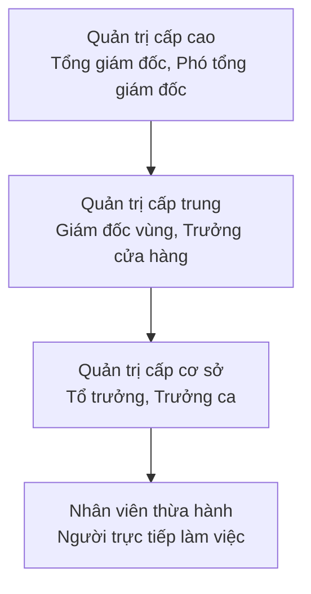
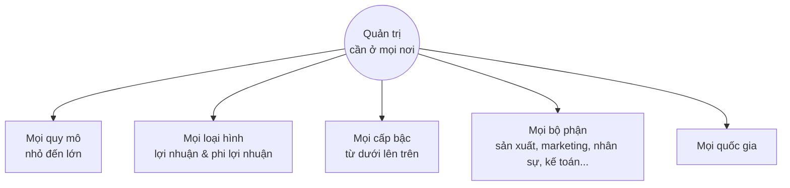

# Bài 1 — Nhà quản trị và bạn ở nơi làm việc
> Cách một nhóm người được điều phối quyết định rất nhiều đến việc nhóm đó thành công hay thất bại.

=== SECTION: Mở đầu: Vì sao một tổ chức có thể sụp đổ dù không ai phá nó? ===

Thử hình dung hai quán phở nằm cạnh nhau, cùng công thức, cùng giá, cùng lượng khách lúc mới mở. Một năm sau, quán thứ nhất mở thêm hai chi nhánh. Quán thứ hai đóng cửa.

Khác biệt có thể đến từ nhiều thứ: vị trí, vốn, cả may rủi. Nhưng một phần rất quan trọng thường không nằm ở nồi nước dùng. Nó nằm ở cách người chủ sắp xếp công việc, dùng người và giữ nhịp vận hành mỗi ngày. Ở Phần 3, chúng ta sẽ quay lại hai quán phở này.

Giờ hãy hình dung một tiệm vật liệu xây dựng gia đình đã mở 25 năm. Mọi việc đều qua tay ông chủ: báo giá, duyệt đơn, giữ sổ, đòi nợ. Nhân viên có chuyện gì cũng đứng chờ ông quyết.

Một ngày ông phải nằm viện hai tuần. Cả tiệm gần như đứng im: không ai dám báo giá, không ai dám duyệt đơn, khách quen bỏ sang chỗ khác.

Không có đối thủ nào phá tiệm. Không có nhân viên nào làm bậy. Tiệm yếu đi từ bên trong, vì chưa từng có ai được chuẩn bị để thay ông. Cuối bài, khi đã có đủ công cụ, chúng ta sẽ quay lại chính tiệm này và gọi tên từng chỗ yếu.

Thông điệp của bài học đầu tiên rất đơn giản: cách một nhóm người được điều phối quyết định rất nhiều đến việc nhóm đó thành công hay thất bại. Và đó chính là chuyện của quản trị.

> [!IMPORTANT] Bài này trả lời 6 câu hỏi
> 1. Nhà quản trị là ai, và họ làm việc ở đâu?
> 2. Tại sao tổ chức cần nhà quản trị?
> 3. Nhà quản trị thực sự làm những việc gì?
> 4. Điều gì đang làm thay đổi công việc của nhà quản trị hôm nay?
> 5. Muốn làm quản lý giỏi thì cần những kỹ năng nào?
> 6. Nếu tôi không định làm sếp, học quản trị có ích gì cho tôi?

## Một hiểu lầm cần bỏ ngay từ đầu

Nhiều người nghĩ: "Môn quản trị là dành cho người muốn làm sếp." Thực tế thì rộng hơn thế nhiều. Ai đi làm cũng sẽ hoặc quản lý người khác, hoặc được người khác quản lý, và thường là cả hai.

Hiểu quản trị giúp bạn làm việc khôn ngoan hơn ở bất kỳ vị trí nào. Điều đó đúng cả khi bạn là nhân viên mới, là người làm tự do hay đang tự kinh doanh nhỏ.

## Về cách tôi viết bài giảng này

Những gì trong bài đều dựa trên kiến thức quản trị học đã được nghiên cứu và kiểm chứng. Nhưng tôi chọn giảng theo cách của mình: bằng ví dụ đời thường và những điều tôi thấy trong thực tế đi làm, thay vì trích dẫn nghiên cứu. Mục tiêu là bạn hiểu và dùng được, không phải học thuộc.

Khi bài viết "thường thì" hay "nhiều nơi", hãy hiểu đó là xu hướng phổ biến, không phải quy luật tuyệt đối. Quản trị rất quan trọng, nhưng không phải mọi thành công hay thất bại của một tổ chức đều do quản trị.

Bài giảng này đủ để bạn nắm toàn bộ kiến thức của Bài 1. Mỗi khái niệm đều được giải thích ngay tại chỗ, kèm ví dụ. Bộ câu hỏi phản biện ở cuối là phần nâng cao, không bắt buộc, dành cho bạn nào tò mò muốn thử sức với những tình huống khó hơn.

## Bản đồ bài học: cái gì cần nắm chắc?

Bài 1 có khá nhiều ý. Để bạn không bị ngợp, tôi chia chúng làm ba tầng:

| Tầng | Nội dung | Bạn cần làm gì |
| --- | --- | --- |
| Cốt lõi | Nhà quản trị là ai; tổ chức là gì; vì sao cần nhà quản trị; hiệu suất và hiệu quả; bốn chức năng; ba nhóm kỹ năng | Hiểu chắc, giải thích được bằng lời của mình, nhận ra được trong đời thực |
| Nhận biết | Ba cấp quản trị; ba nhóm vai trò của nhà quản trị; những thay đổi đang diễn ra; tính phổ biến của quản trị | Nắm được ý chính, không cần nhớ chi tiết |
| Đọc thêm | Mô hình tự quản; danh sách 10 vai trò; học từ thất bại; chính trị công sở | Không bắt buộc, đọc khi bạn muốn đi xa hơn |

=== SECTION: Phần 1. Nhà quản trị là ai, và họ làm việc ở đâu? ===

## Bắt đầu từ nhóm làm bài tập của bạn

Hãy nhớ lại một lần làm bài thuyết trình nhóm năm người. Không ai được bầu làm "trưởng nhóm". Nhưng có một bạn, tạm gọi là Minh, tự đứng ra chia phần: ai tìm tài liệu, ai làm slide, ai thuyết trình.

Minh lập nhóm chat, đặt hạn "tối thứ Năm nộp phần của mình". Tối thứ Năm, Minh mở file ra xem, thấy thiếu phần của một bạn thì nhắn hỏi thăm, rồi gộp tất cả thành một bài hoàn chỉnh.

Minh không có chức danh gì. Nhưng việc Minh đang làm chính là việc của một nhà quản trị.

## Định nghĩa: không phải ai có chức danh "trưởng" mới là nhà quản trị

Ngày trước, phân biệt rất dễ: nhà quản trị là người bảo người khác làm gì và làm thế nào. Ngày nay ranh giới mờ hơn nhiều. Một nhân viên bình thường có thể đang điều phối cả một dự án; ngược lại, có người mang chức danh quản lý nhưng chủ yếu vẫn tự làm chuyên môn.

Vì vậy, hãy nhớ định nghĩa theo việc người đó làm, chứ không theo chức danh:

> [!DEFINITION]
> Nhà quản trị (manager) là người điều phối và giám sát công việc của người khác để tổ chức đạt được mục tiêu.

Định nghĩa này có hai động từ quan trọng. Hãy hiểu chúng qua chính việc Minh đã làm:

- **Điều phối (coordinating)** là sắp xếp để việc của nhiều người ăn khớp với nhau: ai làm phần nào, xong lúc nào, phần của người này nối vào phần của người kia ra sao. Minh chia phần và đặt hạn, đó là điều phối.
- **Giám sát (overseeing)** là theo dõi xem việc có đang đi đúng hướng, đúng hạn không, để kịp giúp đỡ hoặc sửa. Minh mở file kiểm tra và nhắn hỏi bạn còn thiếu, đó là giám sát.

Giám sát ở đây không có nghĩa là đứng sau lưng canh chừng. Nó giống người lái xe liếc nhìn bản đồ: để biết mình còn đúng đường không.

## Chữ quan trọng nhất: "của người khác"

Điểm mấu chốt của định nghĩa là cụm "công việc của người khác". Khi bước vào vai trò quản trị, thành công không còn chủ yếu nằm ở việc bản thân bạn làm tốt đến đâu. Nó ngày càng nằm ở việc bạn giúp người khác và cả nhóm làm tốt đến đâu.

Người đó có thể quản một phòng ban, một nhóm dự án gồm người từ nhiều bộ phận, hay chỉ một nhân viên duy nhất. Nhà quản trị cũng vẫn có thể có phần việc chuyên môn riêng. Chẳng hạn, một tổ trưởng kế toán vẫn tự làm sổ sách, song song với việc phân công và kiểm tra cho các bạn trong tổ.

Còn **nhân viên thừa hành (non-managerial employee)** là người trực tiếp làm một công việc cụ thể và không có ai báo cáo cho mình. Trong tổ chức, "A báo cáo cho B" nghĩa là B là người giao việc, theo dõi và đánh giá công việc của A.

Ở một quán cà phê, bạn pha chế báo cáo cho trưởng ca. Bạn pha chế là nhân viên thừa hành. Trưởng ca, người xếp lịch và nhắc việc cho cả ca, là nhà quản trị.

> [!TIP] Câu dễ nhớ:
> Nhân viên được đánh giá bằng việc của mình. Nhà quản trị được đánh giá bằng kết quả của cả nhóm.

## Ba cấp quản trị trong tổ chức truyền thống

Ở các tổ chức có cấu trúc truyền thống, ta hay hình dung một kim tự tháp. Càng xuống dưới càng đông người. Càng lên trên càng ít người, nhưng mỗi quyết định ảnh hưởng đến càng nhiều người.

| Cấp | Chức danh thường gặp | Việc chính |
| --- | --- | --- |
| Cấp cao | Tổng giám đốc, Giám đốc điều hành, Phó tổng giám đốc | Ra quyết định cho toàn tổ chức; đặt chiến lược và mục tiêu chung |
| Cấp trung | Giám đốc khu vực, Trưởng chi nhánh, Trưởng cửa hàng | Biến chiến lược của cấp trên thành hành động cụ thể |
| Cấp cơ sở | Tổ trưởng, Trưởng ca, Giám sát, Trưởng nhóm | Trực tiếp quản lý những người làm ra sản phẩm hoặc phục vụ khách hàng |

**Chiến lược (strategy)** là hướng đi lớn mà tổ chức chọn để đạt mục tiêu dài hạn: làm gì, cho ai, và không làm gì.

Một ví dụ gần gũi với chuỗi cà phê. Chủ chuỗi quyết định năm tới mở thêm 10 cửa hàng ở miền Trung: đó là việc của cấp cao. Quản lý vùng chọn địa điểm, tuyển trưởng cửa hàng, phân bổ ngân sách: đó là cấp trung. Trưởng ca ở mỗi cửa hàng xếp lịch cho nhân viên pha chế và xử lý khi khách phàn nàn: đó là cấp cơ sở.

## Khi không còn "sếp": mô hình tự quản (đọc thêm)

Một số công ty thử bỏ hẳn các chức danh quản lý và chọn **mô hình tự quản (self-management)**: các nhóm tự quyết định công việc của mình thay vì chờ cấp trên. Một hệ thống tự quản khá nổi tiếng có tên là holacracy.

Ở đó, quyền ra quyết định không nằm ở một chuỗi cấp bậc, mà được giao cho các nhóm và các vai trò. Mỗi người đảm nhận nhiều vai trò, và vai trò thay đổi theo từng dự án. Hôm nay bạn dẫn dắt dự án A, tuần sau bạn là thành viên bình thường trong dự án B.

Nhưng đừng vội kết luận rằng ở đó "không có quản trị". Việc điều phối vẫn phải có người làm, chỉ là người đó thay đổi liên tục và không mang chức danh.

> [!TIP] Câu dễ nhớ:
> Quản trị là một chức năng, không phải một cái ghế.

## Nhà quản trị làm việc ở đâu? Trong các tổ chức

> [!DEFINITION]
> Tổ chức (organization) là một tập hợp người được sắp xếp có chủ đích để đạt một mục đích cụ thể.

"Có chủ đích" nghĩa là có tính toán, có sắp đặt trước, không phải tình cờ mà thành. Hãy so sánh hai nhóm người.

Một đám đông đang đứng chờ xe buýt: có người, nhưng mỗi người một việc, không ai sắp xếp ai. Một ban tổ chức đám cưới: có người, có mục đích chung là đám cưới diễn ra suôn sẻ, và có phân công ai đón khách, ai lo tiệc, ai lo xe.

Nhóm thứ nhất chỉ là một đám đông. Nhóm thứ hai là một tổ chức.

Trường đại học là một tổ chức. Bệnh viện, câu lạc bộ bóng đá, một nhóm tình nguyện, một cửa hàng tạp hóa đầu ngõ cũng vậy. Dù to hay nhỏ, mọi tổ chức đều có ba đặc điểm chung:

1. **Mục đích rõ ràng** — thường được thể hiện qua các mục tiêu cần đạt. Một quán ăn muốn có lãi và giữ chân khách quen; một nhóm tình nguyện muốn quyên góp đủ sách cho một điểm trường.
2. **Con người** — cần có người thực hiện công việc thì mục tiêu mới thành hiện thực.
3. **Cấu trúc có chủ đích** — cách sắp xếp ai làm gì, ai báo cáo cho ai. Cấu trúc có thể rất linh hoạt, như một nhóm nhỏ lập ra để làm một dự án rồi giải tán. Nó cũng có thể rất chặt chẽ, như quân đội với hệ thống cấp bậc, quy định và mô tả công việc rõ ràng.

Ngày càng nhiều tổ chức chọn cách làm linh hoạt: làm theo nhóm, giao tiếp mở, làm ở đâu và lúc nào cũng được. Nhưng dù linh hoạt đến đâu, vẫn cần một cấu trúc nào đó để công việc chạy được, và vẫn cần người điều phối công việc đó.

> [!NOTE] Cẩn thận với chữ "tổ chức":
> Trong tiếng Việt, "tổ chức" có hai nghĩa mà môn học này dùng cả hai. Ở đây nó là danh từ: một tổ chức (organization), như công ty hay câu lạc bộ. Ở Phần 3, bạn sẽ gặp "tổ chức" như một động từ: việc sắp xếp, phân chia công việc (organizing), một trong bốn chức năng quản trị. Khi đọc, hãy xem câu đang nói về "một nơi" hay "một việc".

> [!TIP] Câu dễ nhớ:
> Không có mục đích chung và sự sắp xếp, một nhóm người chỉ là một đám đông.

> [!REFLECT] Câu hỏi nhanh cho bạn:
> Hãy nghĩ về một tổ chức bạn đang tham gia (lớp học, gia đình, nhóm bạn, nơi làm thêm). Mục đích của nó là gì? Ai là người đang "điều phối" — dù có chức danh hay không?

=== SECTION: Phần 2. Vì sao tổ chức cần nhà quản trị? ===

Để trả lời câu hỏi này, hãy theo chân một quán bún bò có năm nhân viên. Bếp nấu ngon, nhân viên chăm chỉ. Vậy quán còn cần ai "quản" nữa?

Có ba lý do, đi từ bức tranh lớn đến từng con người cụ thể.

## Lý do 1: Khi mọi thứ thay đổi, cần người chọn hướng đi

Giả sử trong cùng một năm, giá thịt bò tăng mạnh. Các ứng dụng giao đồ ăn tăng phí. Khách trẻ trong khu dần chuyển sang đặt món online thay vì ngồi ăn tại quán.

Quán nên tăng giá, giảm phần, đổi thực đơn, hay rút khỏi ứng dụng giao đồ ăn? Không ai trong bếp có trách nhiệm trả lời câu hỏi đó. Nếu không ai trả lời, quán sẽ cứ làm như cũ, cho đến khi cuối tháng thấy lỗ.

Nhà quản trị là người nhận ra vấn đề nào quan trọng nhất lúc này và chọn cách đối phó. Thế giới thay đổi càng nhanh, vai trò "người cầm lái" này càng cần.

## Lý do 2: Không có người điều phối, việc khó mà chạy trơn

Mỗi trưa đông khách, phải có người quyết định ai đứng quầy, ai bưng bê, sáng nay nhập bao nhiêu bánh bún cho khỏi thiếu mà cũng khỏi thừa. Đó là tạo ra điều kiện để người khác làm được việc.

Khi món ra chậm, cũng phải có người tìm nguyên nhân: thiếu người, bếp bố trí chưa hợp lý, hay nguyên liệu chuẩn bị chưa kịp? Rồi đưa mọi thứ về đúng nhịp.

Giống như nhạc trưởng: không trực tiếp chơi nhạc cụ nào, nhưng thiếu họ thì dàn nhạc dễ thành một mớ âm thanh hỗn độn.

## Lý do 3: Người quản lý tạo ra khác biệt về kết quả

Vì sao người quản lý lại ảnh hưởng lớn đến vậy? Vì nhân viên gặp người quản lý trực tiếp của mình mỗi ngày. Người đó giao việc ra sao, khen chê thế nào, có công bằng không: những điều nhỏ lặp đi lặp lại ấy quyết định việc đi làm là dễ chịu hay nặng nề.

Từ cảm giác đó, nhân viên chọn cố gắng hết sức hay làm cầm chừng, gắn bó hay tìm chỗ khác. Nó còn ảnh hưởng cả đến việc một người có nhận lời vào làm hay không, sau khi gặp người sẽ làm sếp của mình.

Có một câu nói quen thuộc trong giới nhân sự: "Người ta gia nhập một công ty, nhưng rời bỏ một người sếp." Đó không phải quy luật, nhưng ai đi làm vài năm cũng sẽ thấy nó đúng khá thường xuyên.

Rồi những hành vi nhỏ ấy cộng dồn lại. Một bạn phục vụ làm cầm chừng, khách chỉ hơi phật ý. Cả quán làm cầm chừng, khách sẽ không quay lại.

> [!TIP] Câu dễ nhớ:
> Nhà quản trị không nấu bát bún, nhưng quyết định cả quán có nấu được bát bún ngon mỗi ngày hay không.

Tất nhiên, quản trị không phải là tất cả. Một quán có thể thất bại vì mặt bằng xấu hay vì một đợt dịch bệnh, dù được quản lý tốt. Nhưng với cùng hoàn cảnh, cách điều phối thường tạo ra khác biệt rất rõ.

> [!REFLECT] Liên hệ bản thân:
> Bạn đã bao giờ làm ở một nơi mà công việc không tệ, nhưng bạn vẫn muốn nghỉ vì người quản lý? Hoặc ngược lại, một nơi lương không cao nhưng bạn ở lại vì người dẫn dắt mình? Đó chính là lý do 3 trong đời thực.

=== SECTION: Phần 3. Quản trị là gì, và nhà quản trị thực sự làm gì? ===

## Định nghĩa quản trị

> [!DEFINITION]
> Quản trị (management) là quá trình điều phối và giám sát công việc của người khác để công việc đó được hoàn thành một cách hiệu suất và hiệu quả.

Nhà quản trị là người; quản trị là việc họ làm. Hai chữ quan trọng nhất trong định nghĩa trên là "hiệu suất" và "hiệu quả". Người học hay nhầm hai khái niệm này, nên ta dừng lại kỹ.

## Hiệu suất và hiệu quả: làm đúng cách và làm đúng việc

Trước hết, cần hiểu chữ **nguồn lực (resources)**. Đó là tất cả những gì ta bỏ vào để làm ra kết quả: tiền, thời gian, con người, nguyên liệu, máy móc.

|  | Hiệu suất (Efficiency) | Hiệu quả (Effectiveness) |
| --- | --- | --- |
| Câu hỏi đặt ra | Mình có tốn nhiều nguồn lực quá không? | Mình có đạt được điều mình cần không? |
| Câu dễ nhớ | Làm việc đúng cách | Làm đúng việc |
| Quan tâm đến | Phương tiện — tiền, thời gian, con người, máy móc bỏ ra | Kết quả — mục tiêu cuối cùng |
| Ví dụ quán phở | Nấu nồi nước dùng vừa đủ bán trong ngày, không phải đổ bỏ; xếp đủ người cho giờ đông, không thừa người giờ vắng | Bán đúng món, đúng vị mà khách khu đó thích, để khách quay lại |

Hãy thử với chuyện ôn thi, thứ ai cũng từng trải qua.

- Bạn A đọc xong năm chương chỉ trong hai buổi tối. Rất nhanh, rất ít tốn thời gian: hiệu suất cao. Nhưng đề thi rơi vào chương sáu, chương A bỏ qua. A không đạt mục tiêu: hiệu quả thấp.
- Bạn B ôn đúng các chương sẽ thi và đạt điểm cao: hiệu quả cao. Nhưng B mất ba đêm thức trắng vì ngồi chép lại từng trang giáo trình: hiệu suất thấp.
- Người ôn giỏi nhất là người vừa chọn đúng phần cần ôn, vừa ôn bằng cách ít tốn sức nhất.

Giờ quay lại hai quán phở ở đầu bài. Nếu quán thứ hai đóng cửa vì chuyện quản trị, rất có thể nó hỏng ở một trong hai chỗ. Hoặc quán nấu quá phí: mỗi ngày đổ bỏ nửa nồi nước dùng, thuê thừa người vào giờ vắng. Hoặc quán làm sai việc: mở bán buổi tối, trong khi khu đó toàn khách ăn sáng.

Một tổ chức tốt cần cả hai. Hiệu suất mà thiếu hiệu quả là chạy rất nhanh nhưng sai đường. Hiệu quả mà thiếu hiệu suất là đến được đích nhưng tốn gấp ba xăng.

Nếu phải chọn cái nào trước, hãy nghĩ đến bạn A. Làm sai việc thì dù làm nhanh đến đâu, phần tiết kiệm được cũng thành vô ích. Nhà quản trị giỏi hướng tới cả hai: đạt đúng mục tiêu, với ít lãng phí nhất.

> [!TIP] Câu dễ nhớ:
> Hiệu suất là làm việc đúng cách. Hiệu quả là làm đúng việc. Sai việc thì làm càng giỏi càng phí.

> [!NOTE] Lưu ý về từ ngữ:
> Các giáo trình tiếng Việt không dùng từ thống nhất. Có tài liệu gọi efficiency là "hiệu quả", và gọi effectiveness là "hiệu lực" hay "kết quả". Khi đọc tài liệu khác, đừng bám vào chữ tiếng Việt; hãy bám vào nghĩa: một bên là tốn ít nguồn lực, một bên là đạt đúng mục tiêu.

## Bốn chức năng quản trị

Đầu thế kỷ 20, một nhà quản lý người Pháp tên Henri Fayol cho rằng mọi nhà quản trị đều làm năm việc: lập kế hoạch, tổ chức, chỉ huy, phối hợp và kiểm soát. Ngày nay, người ta rút gọn lại thành bốn chức năng. Có thể hiểu gọn: phần "chỉ huy" và "phối hợp" con người được gom lại, chủ yếu vào chức năng lãnh đạo.

Bốn chức năng này là cách mô tả công việc quản trị phổ biến nhất hiện nay. Mỗi chức năng trả lời một câu hỏi:

**1. Hoạch định (Planning) —** Đặt mục tiêu, chọn chiến lược để đạt mục tiêu, và lập kế hoạch để phối hợp các hoạt động. Nếu bạn không định đi đâu thì đường nào cũng được. Nhưng khi đã có đích đến, bạn phải tính đường đi tốt nhất.

Ví dụ: chủ quán phở đặt mục tiêu "tháng này mỗi sáng bán 200 bát", rồi tính cần nấu bao nhiêu nước dùng, mở cửa từ mấy giờ.

**2. Tổ chức (Organizing) —** Sắp xếp và phân chia công việc. Cụ thể: cần làm những việc gì, ai làm, các việc được gom thành nhóm ra sao, ai báo cáo cho ai, và ai được quyền quyết định việc gì.

Ví dụ: một người lo nồi nước dùng, một người chần bánh và thái thịt, một người bưng bê và thu tiền. Người thu tiền được tự quyết tặng thêm quẩy cho khách quen, nhưng muốn giảm giá thì phải hỏi chủ.

**3. Lãnh đạo (Leading) —** Làm việc cùng và thông qua con người. "Thông qua con người" nghĩa là nhà quản trị không tự tay làm ra mọi kết quả; kết quả đến từ việc của người khác. Vì vậy họ phải khiến người khác vừa biết làm, vừa muốn làm.

Khi nhà quản trị động viên nhân viên, hòa giải mâu thuẫn trong nhóm, chọn cách truyền đạt thông tin phù hợp, là họ đang lãnh đạo. Hình ảnh một trưởng cửa hàng tập hợp cả đội đầu ca, nhắc mục tiêu và cổ vũ tinh thần trước giờ mở cửa là ví dụ điển hình.

**4. Kiểm soát (Controlling) —** Theo dõi, so sánh và điều chỉnh. Sau khi đã có kế hoạch, đã phân công, đã động viên, nhà quản trị cần kiểm tra xem mọi việc có đi đúng hướng không. Kết quả thực tế được đem so với mục tiêu; nếu lệch, họ đưa công việc về đúng quỹ đạo.

Ví dụ: cuối ngày, chủ quán phở đếm được chỉ bán 150 bát, còn thừa một phần ba nồi nước dùng. Hôm sau chủ quán nấu ít lại, và tìm hiểu vì sao khách vắng.

> [!EXAMPLE] Ví dụ tổng hợp — tổ chức một buổi liên hoan cuối năm cho lớp:
> - Hoạch định: Mục tiêu là 40 người tham dự, ngân sách 8 triệu, tổ chức vào tối thứ Bảy cuối tháng 12.
> - Tổ chức: Chia ban: ban địa điểm, ban văn nghệ, ban hậu cần, ban thu chi; mỗi ban có một trưởng ban.
> - Lãnh đạo: Nhắc nhở, động viên các ban; giải quyết khi hai bạn cãi nhau về chọn nhà hàng.
> - Kiểm soát: Một tuần trước ngày diễn ra, kiểm tra đã thu đủ tiền chưa, đã đặt chỗ chưa; thiếu thì xử lý ngay.

> [!WARNING] Lưu ý quan trọng:
> Bốn chức năng này không nhất thiết diễn ra theo đúng thứ tự 1-2-3-4. Trong thực tế, nhà quản trị có thể đang kiểm soát việc này thì phải lập kế hoạch cho việc khác, xen lẫn với động viên nhân viên. Vì vậy sơ đồ ở trên là một vòng tròn: kiểm soát thấy lệch thì quay lại hoạch định. Dù thứ tự thế nào, nhà quản trị nào cũng làm đủ cả bốn.

> [!TIP] Câu dễ nhớ:
> Đi đâu? Ai làm gì? Làm sao để mọi người cùng làm? Có đang đi đúng đường không?

## Các vai trò của nhà quản trị (Mintzberg)

Bốn chức năng trả lời câu hỏi "nhà quản trị làm những loại việc gì?". Nhưng nhà nghiên cứu Henry Mintzberg muốn biết họ thực sự làm gì trong một ngày, nên ông đi theo quan sát các nhà quản lý ngoài đời.

Ông thấy công việc quản trị có thể mô tả qua các **vai trò (managerial roles)**, tức những kiểu hành động mà người ta trông đợi ở một nhà quản trị. Hãy nghĩ đến vai diễn: cùng một người, lúc này đóng vai người đại diện, lúc khác đóng vai người xử lý sự cố. Các vai trò này gom thành 3 nhóm, và đây là phần bạn cần nắm:

| Nhóm vai trò | Hiểu đơn giản | Ví dụ ở một chuỗi cà phê |
| --- | --- | --- |
| Con người | Làm việc với người trong và ngoài tổ chức, kể cả những việc mang tính nghi thức | Kèm nhân viên mới; dự lễ khai trương chi nhánh; giữ quan hệ với chủ mặt bằng |
| Thông tin | Thu thập thông tin, truyền tin trong nội bộ, phát ngôn ra bên ngoài | Xem báo cáo doanh thu; họp đầu tuần báo tin cho nhân viên; trả lời báo chí |
| Quyết định | Đưa ra lựa chọn và giải quyết vấn đề | Quyết định ra món mới; xử lý khi máy pha hỏng; chia ngân sách; thương lượng giá cà phê hạt |

> [!TIP] Mẹo nhớ:
> Nhà quản trị làm việc với người, với tin, và ra quyết định.

Nhà quản trị ở mọi loại tổ chức và mọi cấp đều đóng cả ba nhóm vai trò này, nhưng mức độ nặng nhẹ khác nhau theo cấp bậc. Càng lên cao, những việc như đại diện cho tổ chức, phát ngôn, giữ quan hệ bên ngoài và đàm phán càng chiếm nhiều thời gian. Ở cấp cơ sở, việc trực tiếp hướng dẫn, động viên nhân viên lại quan trọng hơn.

### Đọc thêm: 10 vai trò cụ thể.

Nếu muốn đi sâu, đây là 10 vai trò Mintzberg tìm ra. Bạn không cần thuộc bảng này; chỉ cần nhận ra chúng khi gặp.

| Nhóm | Vai trò | Hiểu đơn giản | Ví dụ |
| --- | --- | --- | --- |
| Con người | Người đại diện | Có mặt trong các dịp mang tính nghi thức, thay mặt tổ chức | Cắt băng khai trương, ký giấy khen, dự đám cưới nhân viên |
|  | Người lãnh đạo | Tuyển dụng, đào tạo, động viên nhân viên | Kèm cặp nhân viên mới trong tuần đầu |
|  | Người liên lạc | Giữ quan hệ với người bên ngoài nhóm | Giữ mối quan hệ với đối tác, với các phòng ban khác |
| Thông tin | Người thu thập thông tin | Nắm bắt thông tin trong và ngoài tổ chức | Đọc báo cáo, theo dõi đối thủ, nắm tâm tư nhân viên |
|  | Người truyền tin nội bộ | Chuyển thông tin đến người trong tổ chức | Họp đầu tuần, gửi thông báo nội bộ |
|  | Người phát ngôn | Nói thay tổ chức với bên ngoài | Trả lời báo chí, trình bày với nhà đầu tư |
| Quyết định | Người khởi xướng | Tìm cơ hội, bắt đầu thay đổi | Đề xuất mở dòng sản phẩm mới |
|  | Người xử lý sự cố | Giải quyết khi có chuyện bất ngờ | Nhà cung cấp giao trễ, khách phàn nàn trên mạng xã hội |
|  | Người phân bổ nguồn lực | Quyết định ai được bao nhiêu tiền, người, thời gian | Chia ngân sách quý cho các nhóm |
|  | Người đàm phán | Thương lượng để đạt thỏa thuận | Đàm phán giá với nhà cung cấp, thỏa thuận lương |

## Vậy nên dùng cách nhìn nào?

Cả hai đều hữu ích và bổ sung cho nhau:

- Bốn chức năng là cách mô tả được dùng phổ biến nhất, vì nó gọn và dễ xếp hàng nghìn hoạt động khác nhau vào bốn "ngăn kéo" rõ ràng.
- Các vai trò cho ta thấy chi tiết hơn nhà quản trị làm gì bên trong từng chức năng. Ví dụ, khi làm chức năng kiểm soát, nhà quản trị thường đóng vai người thu thập thông tin và người xử lý sự cố.
- Có những việc khó xếp vào một chức năng nào, như ra chụp ảnh cùng khách hay trả lời phỏng vấn. Khi đó, nhìn theo vai trò (đại diện, phát ngôn) sẽ dễ gọi tên hơn.

> [!REFLECT] Thử sức:
> Hãy nhớ lại một ngày làm việc của một người quản lý bạn biết. Họ đã đóng những vai trò nào, thuộc nhóm nào: con người, thông tin hay quyết định?

=== SECTION: Phần 4. Điều gì đang thay đổi công việc của nhà quản trị? ===

Hãy bắt đầu bằng một cửa hàng quần áo nhỏ, bán cả ở tiệm lẫn trên mạng.

Vài năm trước, chị chủ quản lý bằng cách đứng ở tiệm cả ngày: nhìn nhân viên bán hàng, đếm hàng, cuối ngày chốt sổ. Bây giờ, hai bạn trả lời tin nhắn khách làm việc ở nhà. Đơn hàng được giao bởi các shipper không phải nhân viên của chị.

Chị xem doanh thu trên phần mềm, dùng AI soạn bài đăng bán hàng. Còn nhân viên thì than mệt, vì tin nhắn khách đến cả lúc nửa đêm.

Không có gì trong câu chuyện này là lạ. Nhưng nó cho thấy ba thay đổi lớn mà người quản lý hôm nay phải đối mặt.

## Thay đổi 1: Không còn nhìn thấy nhân viên làm việc

- **Làm việc từ xa (remote work):** làm việc ở ngoài nơi làm việc của công ty, ví dụ ở nhà.
- **Làm việc kết hợp (hybrid work):** vừa làm từ xa, vừa đến công ty, ví dụ 3 ngày ở văn phòng, 2 ngày ở nhà.

Sau đại dịch, nhiều nơi nhận ra có những việc làm ở đâu cũng được. Người lao động thích sự linh hoạt này vì nó giúp họ cân bằng công việc và cuộc sống. Với nhiều loại việc, làm từ xa vẫn cho kết quả tốt, có khi còn tốt hơn; với loại việc khác thì không.

Điều này đòi hỏi gì ở người quản lý? Chị chủ cửa hàng không thể ngồi cạnh bạn nhân viên đang trả lời tin nhắn ở nhà. Chị phải chuyển từ quản lý quá trình ("bạn có đang ngồi làm không?") sang quản lý kết quả ("khách có được trả lời nhanh không, đơn có chốt được không, khách có quay lại không?").

Nhưng quản lý bằng con số cũng có một cái bẫy: người ta sẽ chạy theo đúng con số được đo. Nếu chị chỉ đếm số tin nhắn mỗi bạn trả lời mỗi ngày, nhân viên sẽ trả lời thật nhanh cho đủ số, dù khách chưa được giải quyết xong. Người làm chậm hơn vì đang kèm bạn mới lại bị đánh giá thấp.

Vì vậy người quản lý giỏi thường đo vài thứ cùng lúc, chẳng hạn cả số lượng lẫn mức độ hài lòng của khách. Họ vẫn trò chuyện định kỳ với từng người, để biết những điều con số không cho thấy.

## Thay đổi 2: Công nghệ, AI và người làm tự do

**Chuyển đổi số (digital transformation)** không có nghĩa là mua phần mềm mới, mà là nghĩ lại cách làm việc. Chuyển từ ghi sổ tay sang phần mềm bán hàng mới chỉ là thay công cụ.

Dùng dữ liệu từ phần mềm để biết mặt hàng nào bán chạy vào giờ nào, rồi sắp xếp lại ca làm và cách nhập hàng: đó mới là chuyển đổi số.

**Trí tuệ nhân tạo (artificial intelligence, AI)** là các hệ thống máy tính được làm ra để thực hiện những việc thường cần đến trí óc con người: nhận biết, suy luận, dự đoán, viết nội dung, hay ra quyết định. AI có thể hỗ trợ con người, hoặc tự làm thay một phần công việc: trả lời tin nhắn khách lúc nửa đêm, gợi ý nên nhập hàng gì, soạn nháp một bài đăng.

Theo kinh nghiệm của tôi, AI hữu ích nhất khi người và máy làm cùng nhau: máy làm nhanh phần lặp lại, người kiểm tra và quyết định. Một người nhập hàng có thể dùng dữ liệu để biết mẫu nào sẽ bán chạy, nhưng vẫn phải tự tay sờ vải, thử độ vừa trước khi nhập.

AI cũng có thể viết sai, hoặc làm lộ thông tin nếu người dùng dán dữ liệu của khách vào. Vì vậy việc của người quản lý là đặt ra quy tắc dùng rõ ràng, thay vì cấm hẳn hay mặc kệ.

**Kinh tế gig (gig economy)**, hay thị trường lao động làm tự do theo từng việc, là khi người lao động nhận việc theo từng đơn, từng lần, thay vì làm nhân viên chính thức. Shipper, tài xế xe công nghệ, cộng tác viên bán hàng online là những ví dụ quen thuộc. Nhiều người chạy cho vài nơi cùng lúc để đủ thu nhập.

Với người quản lý, điều này đặt ra câu hỏi mới. Không ép được lịch làm thì sắp xếp thế nào? Giữ chất lượng bằng cách nào? Có trách nhiệm gì với sự an toàn của họ?

Lưu ý: đừng nhầm kinh tế gig với "kinh tế thị trường tự do", đó là một khái niệm khác hẳn.

> [!TIP] Câu dễ nhớ:
> Đổi công cụ chưa phải chuyển đổi số. Đổi cách làm việc mới là chuyển đổi số.

## Thay đổi 3: Chăm lo cho con người một cách toàn diện hơn

**Sự khỏe mạnh toàn diện của người lao động (employee well-being)** là cảm giác cuộc sống của mình nhìn chung đang ổn và tích cực. Nó gồm nhiều mặt cùng lúc: cơ thể khỏe (ngủ đủ, không kiệt sức), tinh thần ổn (không lo âu, căng thẳng kéo dài), và cảm giác được đối xử tử tế, thấy công việc có ý nghĩa.

Vì vậy nó rộng hơn chữ "vui vẻ". Một người vẫn có thể cười nói ở chỗ làm trong khi đang kiệt sức.

Người lao động hôm nay, nhất là người trẻ, mong đợi nhiều hơn một chỗ làm có lương: họ muốn không bị vắt kiệt, muốn được đối xử tử tế. Và ai đi làm cũng thấy: rất nhiều khi, nguồn căng thẳng lớn nhất không phải là công việc, mà là cách người quản lý đối xử với mình. Người ít căng thẳng thì thường làm việc tốt hơn.

Vì vậy người quản lý ngày nay cần thêm kỹ năng **kèm cặp (coaching)**, tức giúp nhân viên tự tìm ra cách làm tốt hơn thay vì chỉ ra lệnh, và kỹ năng hỗ trợ cảm xúc. Những việc rất cụ thể: không nhắn việc lúc 11 giờ đêm nếu không gấp, nhận ra khi một bạn đang quá tải, hỏi han khi thấy ai đó khác thường.

Một phần khác là **sự công bằng và hòa nhập (inclusion)**: người thuộc mọi vùng miền, giới tính, độ tuổi, hoàn cảnh đều được đối xử công bằng và thấy mình thuộc về. Ở nơi làm việc, điều này có thể rất cụ thể: không đùa cợt giọng nói vùng miền, không chỉ giao việc hay cho người thân quen với sếp, không coi nhẹ ý kiến của người trẻ hay người lớn tuổi.

Lợi ích không chỉ là giữ được người giỏi. Một nhóm đa dạng thường có nhiều ý tưởng hơn và hiểu khách hàng hơn, vì khách hàng của bạn cũng đa dạng như vậy.

> [!TIP] Câu dễ nhớ:
> Ngày trước, quản lý là nhìn người ta làm. Hôm nay, quản lý là giúp người ta làm tốt cả khi mình không nhìn thấy.

> [!REFLECT] Liên hệ bản thân:
> Nếu bạn từng làm thêm ở quán cà phê, shop hay chạy giao hàng: bạn đã gặp thay đổi nào trong ba thay đổi này? Người quản lý của bạn xử lý nó tốt hay chưa?

=== SECTION: Phần 5. Nghề quản trị và những kỹ năng cần có ===

## Nghề quản trị có tương lai không?

Hãy nhìn quanh bạn. Một quán cà phê mở thêm chi nhánh thì cần trưởng cửa hàng. Một công ty phần mềm lớn lên thì cần trưởng nhóm. Một nhóm tình nguyện mở rộng ra nhiều tỉnh thì cần người điều phối.

Tổ chức càng lớn và càng phức tạp, càng cần người biết điều phối. Cơ hội cụ thể thì khác nhau theo ngành và theo từng thời điểm, nhưng nhu cầu về người biết dẫn dắt một nhóm khó mà biến mất.

Phần thưởng của vai trò quản lý cũng không chỉ là thu nhập. Làm quản lý, bạn được:

- tạo ra một môi trường nơi mọi người phát huy hết khả năng;
- nhìn một bạn nhân viên mới, từng lóng ngóng, sau một năm đã tự tin xử lý những khách khó nhất nhờ bạn kèm cặp;
- suy nghĩ sáng tạo, gặp gỡ nhiều người trong và ngoài tổ chức;
- được ghi nhận, có tiếng nói và có ảnh hưởng thực sự đến kết quả chung.

## Cái bẫy thăng chức: giỏi chuyên môn chưa chắc giỏi quản lý

Chúng ta đều từng nghe về một "người sếp tồi": hoặc khiến công việc thành cực hình, hoặc chẳng biết nhân viên mình đang làm gì. Chuyện này thường xảy ra khi tổ chức thăng chức người giỏi chuyên môn mà không kiểm tra hay đào tạo kỹ năng quản lý.

Ai đi làm cũng từng thấy cảnh này. Người bán hàng giỏi nhất được lên làm trưởng nhóm. Vài tháng sau, doanh số cả nhóm không tăng, còn người trưởng nhóm mới thì mệt mỏi.

Vì sao? Vì bán hàng giỏi là tự mình thuyết phục được khách. Còn quản lý người bán hàng là giúp năm người khác thuyết phục được khách: chia khách cho hợp, dạy cách chào hàng, động viên khi họ bị từ chối liên tục. Đó là hai bộ kỹ năng khác nhau.

Điều này không có nghĩa người bán giỏi sẽ thành sếp tệ. Nó chỉ có nghĩa là giỏi việc này không tự động giỏi việc kia. Tổ chức hiểu điều đó thường đào tạo quản lý mới ngay trước hoặc ngay khi lên chức: cách giao việc, cách góp ý, cách quản lý thời gian.

> [!TIP] Câu dễ nhớ:
> Giỏi làm việc và giỏi giúp người khác làm việc là hai nghề khác nhau.

## Ba nhóm kỹ năng của nhà quản trị (Katz)

Vậy một nhà quản trị cần những kỹ năng gì? Nhà nghiên cứu Robert Katz chia chúng thành ba nhóm. Điều thú vị là mức độ cần của mỗi nhóm thay đổi theo cấp bậc.

1. **Kỹ năng chuyên môn (technical skills) —** kiến thức và kỹ thuật đặc thù của một công việc cụ thể. Ví dụ: kế toán biết lập báo cáo tài chính, bếp trưởng biết nấu, trưởng nhóm lập trình biết viết mã. Kỹ năng này quan trọng nhất với quản lý cấp cơ sở, vì họ làm việc sát với người làm chuyên môn: phải biết nghề mới hướng dẫn và kiểm tra được.
2. **Kỹ năng quan hệ con người (human skills) —** khả năng làm việc tốt với người khác, cả từng người lẫn cả nhóm: giao tiếp, động viên, dẫn dắt, tạo dựng niềm tin. Vì nhà quản trị nào cũng đạt kết quả thông qua con người, kỹ năng này quan trọng như nhau ở mọi cấp.
3. **Kỹ năng tư duy (conceptual skills) —** khả năng suy nghĩ về những tình huống trừu tượng và phức tạp. Người có kỹ năng này nhìn tổ chức như một tổng thể, hiểu các bộ phận liên quan với nhau thế nào, và thấy tổ chức đứng ở đâu trong môi trường rộng lớn hơn.

Kỹ năng tư duy càng lên cao càng quan trọng, vì quyết định ở cấp cao chạm đến toàn bộ tổ chức. Ví dụ, giám đốc một chuỗi cà phê định mở thêm năm cửa hàng. Người đó phải thấy trước chuyện kéo theo: cần thêm bếp trung tâm, thêm quản lý vùng, dòng tiền sẽ căng trong vài tháng đầu.

| Cấp quản trị | Kỹ năng tư duy | Kỹ năng quan hệ con người | Kỹ năng chuyên môn |
| --- | --- | --- | --- |
| Cấp cao | Rất cần | Cần như mọi cấp | Ít cần hơn |
| Cấp trung | Cần ở mức vừa | Cần như mọi cấp | Cần ở mức vừa |
| Cấp cơ sở | Ít cần hơn | Cần như mọi cấp | Rất cần |

> [!TIP] Một hình ảnh dễ nhớ:
> Một đầu bếp giỏi được lên làm bếp trưởng thì vẫn cần tay nghề nấu (chuyên môn), nhưng giờ phải biết điều phối đội bếp (con người). Nếu sau này làm giám đốc cả chuỗi nhà hàng, người đó ít khi cầm chảo, mà dành phần lớn thời gian nghĩ về thực đơn cho từng thị trường, chiến lược mở rộng, đối thủ cạnh tranh (tư duy). Càng lên cao, càng bớt cầm chảo, càng phải nhìn cả căn bếp.

Bên trong ba nhóm lớn này, bối cảnh mới đòi hỏi thêm những kỹ năng cụ thể. Nổi bật hiện nay là **sự thấu cảm (empathy)**: khả năng hiểu cảm xúc của người khác và phản hồi bằng sự quan tâm. Người lao động luôn mang theo nhiều điều mà ta không nhìn thấy trên bề mặt, nhất là khi làm từ xa và khi áp lực tinh thần ngày càng lớn.

Một biểu hiện rất cụ thể của kỹ năng con người là trò chuyện với nhân viên về con đường nghề nghiệp của họ: họ đang làm tốt đến đâu, cần học thêm gì, phía trước có cơ hội nào. Trong thực tế, nhiều người quản lý hiếm khi làm việc này, trong khi nhiều nhân viên, nhất là người trẻ, rất mong có.

Việc này không tốn nhiều: khoảng 30 phút, vài tháng một lần. Nhưng nó ảnh hưởng không nhỏ đến việc nhân viên có ở lại hay không.

> [!REFLECT] Liên hệ bản thân:
> Trong ba nhóm kỹ năng, bạn đang mạnh nhóm nào nhất? Nhóm nào bạn có thể bắt đầu luyện ngay từ khi còn đi học, chẳng hạn qua các buổi làm việc nhóm?

=== SECTION: Phần 6. Không định làm sếp, có cần học quản trị không? ===

Câu trả lời là có, vì ba lý do.

## Lý do 1: Quản trị có mặt ở khắp nơi

Quản trị cần thiết trong mọi loại hình, mọi quy mô, mọi cấp độ, mọi bộ phận và ở mọi quốc gia. Người ta gọi đây là **tính phổ biến của quản trị (universality of management)**.

Điều đó không có nghĩa là ở đâu quản trị cũng giống hệt nhau. Một trưởng nhóm kiểm thử phần mềm và tổng giám đốc của chính công ty đó đều hoạch định, tổ chức, lãnh đạo và kiểm soát. Khác biệt nằm ở mức độ và trọng tâm, không phải ở bản chất công việc.

Tổ chức được quản lý tốt thường giữ khách tốt hơn và đứng vững hơn khi gặp khó khăn. Tổ chức quản lý kém thì dễ mất dần khách và doanh thu. Học quản trị giúp bạn nhận ra khi nào một tổ chức đang bị quản lý kém, và biết cách góp phần sửa nó.

## Lý do 2: Hoặc bạn quản lý, hoặc bạn được quản lý

Sau khi ra trường và đi làm, hầu hết chúng ta sẽ ở một trong hai vị trí, hoặc cả hai. Nếu bạn muốn làm quản lý, môn học này là nền móng. Nếu không, bạn vẫn phải làm việc với người quản lý mỗi ngày.

Hiểu quản trị giúp bạn hiểu vì sao sếp mình hành xử như vậy. Ví dụ, khi sếp hỏi tiến độ mỗi thứ Sáu, đó thường không phải vì nghi ngờ bạn, mà vì sếp đang làm chức năng kiểm soát. Hiểu điều đó, bạn có thể chủ động gửi cập nhật trước khi được hỏi, và được tin tưởng hơn.

## Lý do 3: Hiểu cách nhà quản trị nghĩ giúp bạn làm việc tốt hơn

Bạn muốn làm kế toán, lập trình viên, nhà thiết kế hay nghiên cứu thị trường? Hiểu cách nhà quản trị suy nghĩ vẫn giúp bạn đạt kết quả tốt hơn và tiến xa hơn. Bạn sẽ biết việc của mình góp vào mục tiêu chung ở chỗ nào, và việc nào đáng ưu tiên.

Và biết đâu, bạn sẽ làm quản lý lúc nào không hay. Một người bắt đầu là kiểm toán viên, vài năm sau có thể đang dẫn dắt cả một nhóm kiểm toán. Một lập trình viên giỏi rồi cũng có thể được giao làm trưởng nhóm.

Ngay cả khi làm việc độc lập, như làm tự do hay kinh doanh một mình, bạn vẫn dùng rất nhiều tư duy và kỹ năng của quản trị: hoạch định công việc, phân bổ thời gian và tiền bạc, kiểm soát kết quả. Và khi công việc lớn đến mức cần thêm người, bạn sẽ chính thức bước vào vai trò quản trị.

> [!TIP] Câu dễ nhớ:
> Không làm sếp, bạn vẫn đang làm việc bên trong một hệ thống quản trị. Hiểu hệ thống đó giúp bạn làm việc thông minh hơn.

> [!REFLECT] Liên hệ bản thân:
> Hãy nghĩ về công việc bạn muốn làm sau khi ra trường. Trong công việc đó, bạn sẽ phải tự hoạch định, sắp xếp, phối hợp với ai, hay kiểm tra kết quả của việc gì, dù không mang chức danh quản lý?

=== SECTION: Góc đọc thêm ===
> Phần này không bắt buộc. Nó dành cho bạn muốn nhìn xa hơn Bài 1.

## Học từ thất bại

Nhiều người thành công từng thất bại trước khi thành công:

- Bill Gates và Paul Allen, thời còn học phổ thông, làm Traf-O-Data, một thiết bị phân tích dữ liệu giao thông. Buổi trình diễn đầu tiên hỏng, và ý tưởng nhanh chóng lỗi thời khi chính quyền tự cung cấp dịch vụ tương tự miễn phí. Nhưng kỹ năng lập trình có được từ dự án đó đã giúp họ lập nên Microsoft.
- Reid Hoffman, trước khi lập LinkedIn, từng làm mạng xã hội SocialNet và thất bại, vì nó muốn làm mọi thứ, từ tìm bạn cùng phòng đến tìm người yêu. Bài học ông rút ra: tập trung vào một nhu cầu thật sự quan trọng với người dùng, và làm thật tốt.
- Amazon từng lỗ rất nặng với điện thoại Fire Phone, nhưng kinh nghiệm từ đó góp phần tạo ra loa thông minh Echo sau này.

Không ai thắng mãi. Điều làm nên khác biệt là dám nhìn lại, thay đổi và thích nghi sau mỗi lần vấp ngã. Điều này đúng với nhà quản trị, với tổ chức, và với chính bạn.

## Chính trị công sở

Trong thế giới lý tưởng, người giỏi luôn được thăng chức và ai cũng nói thật. Thực tế thì khác: hầu như tổ chức nào cũng có "chính trị". Lý do là mỗi người, mỗi nhóm có mong muốn riêng, trong khi ngân sách, chức vụ, tăng lương thì có hạn.

Hơn nữa, rất nhiều thứ lại không có thước đo rõ ràng. Thế nào là "làm tốt"? Người này thấy là "tinh thần đồng đội", người khác lại thấy là "ba phải".

Từ kinh nghiệm đi làm, tôi thấy vài nguyên tắc giúp bạn đi qua chuyện này mà vẫn giữ sự chính trực:

- Nói bằng ngôn ngữ mục tiêu chung. Khi đề xuất điều gì, hãy cho thấy nó có lợi cho tổ chức, không chỉ cho bạn.
- Hiểu tổ chức coi trọng điều gì: cách làm việc, cách ứng xử, mức độ chấp nhận rủi ro.
- Tạo ra giá trị thật, đặc biệt là chuyên môn vững.
- Để người khác thấy việc bạn làm qua báo cáo tiến độ đều đặn, nhất là khi làm từ xa, nhưng đừng thành khoe khoang.
- Xây mạng lưới quan hệ với cả cấp trên, ngang cấp và cấp dưới; tìm một người đi trước đáng tin để học hỏi.
- Hỗ trợ người quản lý trực tiếp của bạn: hiểu họ đánh giá bạn theo tiêu chí gì, và không nói xấu họ sau lưng.

Hiểu chính trị công sở không có nghĩa là trở nên mưu mô. Nó giúp bạn không ngây thơ, và bảo vệ được những ý tưởng tốt của mình. Nếu muốn thử sức, Câu 15 trong bộ câu hỏi nâng cao có một tình huống để luyện cách phân biệt khéo léo với thao túng.

=== SECTION: Tổng kết bài 1 ===

## Quay lại câu hỏi đầu bài

Vì sao tiệm vật liệu xây dựng ở đầu bài yếu đi, dù không ai phá nó? Giờ ta đã có đủ từ ngữ để trả lời.

- Mọi việc điều phối và giám sát dồn vào một người, nên người đó vắng là không ai điều phối.
- Việc không được chia ra và giao quyền cho ai (thiếu chức năng tổ chức), nên nhân viên không quen tự quyết.
- Không ai được dạy để thay ông (thiếu chức năng lãnh đạo, phát triển con người).
- Chưa ai từng tính trước "nếu ông vắng thì sao" (thiếu hoạch định).

Ông chủ là một người giỏi. Nhưng ông chưa chuyển từ "người giỏi làm mọi việc" sang "nhà quản trị giúp người khác làm được việc". Đó cũng là ý chính của cả Bài 1.

> [!IMPORTANT] Ghi nhớ trong 8 dòng
> 1. Nhà quản trị là người điều phối và giám sát công việc của người khác để tổ chức đạt mục tiêu; quản trị là một chức năng, không phải một cái ghế.
> 2. Tổ chức có ba đặc điểm: mục đích rõ ràng, con người, cấu trúc có chủ đích.
> 3. Tổ chức cần nhà quản trị để chọn hướng khi mọi thứ thay đổi, để việc chạy trơn, và vì người quản lý ảnh hưởng mạnh đến sự gắn bó của nhân viên.
> 4. Hiệu suất là làm việc đúng cách (ít lãng phí); hiệu quả là làm đúng việc (đạt mục tiêu); tổ chức tốt cần cả hai.
> 5. Bốn chức năng: hoạch định, tổ chức, lãnh đạo, kiểm soát; chúng xen kẽ nhau chứ không theo thứ tự cứng.
> 6. Nhà quản trị đóng ba nhóm vai trò: con người, thông tin, quyết định; cấp càng cao càng hướng ra bên ngoài.
> 7. Ba thay đổi lớn: làm từ xa và kết hợp; công nghệ, AI và kinh tế gig; chăm lo sự khỏe mạnh toàn diện và sự hòa nhập.
> 8. Ba nhóm kỹ năng: chuyên môn (cần nhất ở cấp cơ sở), con người (cần như nhau ở mọi cấp), tư duy (càng lên cao càng cần).

## Từ khóa của bài

| Thuật ngữ | Tiếng Anh | Nghĩa ngắn gọn |
| --- | --- | --- |
| Nhà quản trị | Manager | Người điều phối, giám sát công việc của người khác để tổ chức đạt mục tiêu |
| Nhân viên thừa hành | Non-managerial employee | Người trực tiếp làm một việc cụ thể, không có ai báo cáo cho mình |
| Điều phối | Coordinating | Sắp xếp để việc của nhiều người ăn khớp với nhau |
| Giám sát | Overseeing | Theo dõi xem việc có đi đúng hướng, đúng hạn không |
| Tổ chức | Organization | Tập hợp người được sắp xếp có chủ đích vì một mục đích |
| Chiến lược | Strategy | Hướng đi lớn để đạt mục tiêu dài hạn |
| Quản trị | Management | Điều phối, giám sát công việc của người khác sao cho hiệu suất và hiệu quả |
| Nguồn lực | Resources | Tiền, thời gian, con người, nguyên liệu, máy móc bỏ vào công việc |
| Hiệu suất | Efficiency | Kết quả nhiều nhất từ nguồn lực ít nhất — làm việc đúng cách |
| Hiệu quả | Effectiveness | Làm những việc giúp đạt mục tiêu — làm đúng việc |
| Hoạch định | Planning | Đặt mục tiêu, chọn chiến lược, lập kế hoạch |
| Tổ chức (chức năng) | Organizing | Sắp xếp, phân chia công việc và quyền quyết định |
| Lãnh đạo | Leading | Làm việc cùng và thông qua con người |
| Kiểm soát | Controlling | Theo dõi, so sánh, điều chỉnh |
| Vai trò quản trị | Managerial roles | Những kiểu hành động người ta trông đợi ở nhà quản trị: con người, thông tin, quyết định |
| Mô hình tự quản | Self-management | Các nhóm tự quyết công việc thay vì chờ cấp trên; holacracy là một hệ thống tự quản nổi tiếng |
| Làm việc từ xa / kết hợp | Remote / hybrid work | Làm ngoài công ty / vừa ở công ty vừa ở ngoài |
| Chuyển đổi số | Digital transformation | Nghĩ lại cách làm việc nhờ công nghệ, không chỉ thay công cụ |
| Kinh tế gig | Gig economy | Thị trường lao động của người làm tự do theo từng việc |
| Sự khỏe mạnh toàn diện của người lao động | Employee well-being | Cảm giác cuộc sống nhìn chung ổn và tích cực, gồm cả thể chất, tinh thần và cảm giác được đối xử tử tế |
| Sự hòa nhập | Inclusion | Mọi người, dù khác biệt, đều được đối xử công bằng và thấy mình thuộc về |
| Kỹ năng chuyên môn | Technical skills | Kiến thức, kỹ thuật của một công việc cụ thể |
| Kỹ năng quan hệ con người | Human skills | Khả năng làm việc tốt với người khác |
| Kỹ năng tư duy | Conceptual skills | Khả năng nhìn tổ chức như một tổng thể |
| Tính phổ biến của quản trị | Universality of management | Quản trị cần ở mọi loại, mọi quy mô, mọi cấp, mọi nơi |
