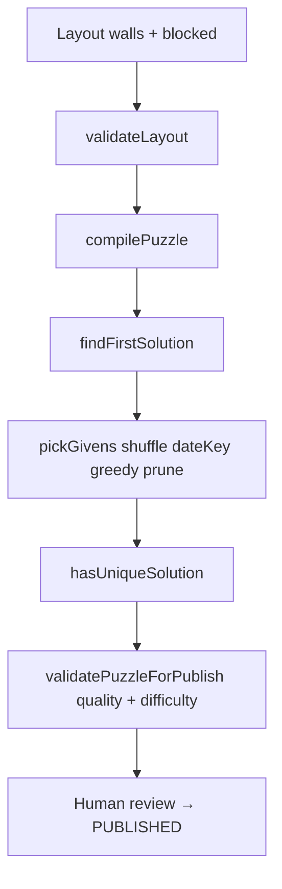

# ThinkGrid — Tài liệu tổng hợp cho chuyên gia (Expert Review)

**Phiên bản:** 1.3 — 2026-05-25 (đóng gói handoff)  
**Gói gửi chuyên gia:** [`thinkgrid-expert-handoff.md`](./thinkgrid-expert-handoff.md) (mục lục + verification)  
**Chi tiết triển khai:** [`thinkgrid-technical-spec.md`](./thinkgrid-technical-spec.md) v1.6 · **Vận hành:** [`thinkgrid-production-checklist.md`](./thinkgrid-production-checklist.md) · **UX:** [`thinkgrid-ux-plan.md`](./thinkgrid-ux-plan.md)

---

## 0. Executive summary

ThinkGrid là daily logic puzzle **One-Up style** (segment-based, **không** Sudoku):

- Lưới `size × size` (3–9), ô blocked, **tường** chia segment ngang/dọc.
- Mỗi segment dài `L` chứa đúng permutation `{1..L}` (không trùng trong segment).
- `maxAllowedValue(cell) = min(L_H, L_V)` tại giao hai segment.
- Publish yêu cầu **đúng 1 nghiệm** (`countSolutions` ≤ 2).

**Verification tự động (chuẩn duy nhất — 2026-05-25):**

```text
npx vitest run src/lib/puzzle  → 54 passed (13 files)
npm run build                  → OK
```

**Mục tiêu review:** Xác nhận bản hiện tại **đủ an toàn cho public beta / production seed có kiểm soát** — **không** xác nhận “hoàn hảo”. Reviewer **chỉ ra chỗ có thể sai**, đặc biệt seed algorithm, content quality, UX learnability.

**Chưa có (trước public rộng):** Playwright E2E; ≥30 ngày puzzle future; Mức 3 generator (candidate pool).

---

## 0.1 “Production seed có kiểm soát” nghĩa là gì?

| **Có nghĩa là** | **Chưa có nghĩa là** |
|-----------------|----------------------|
| Mỗi puzzle pass `validatePuzzleForPublish` (unique + quality **errors**) | Generator tự động đủ tốt **dài hạn** không cần người |
| `evaluateDifficulty` → warnings + log score khi seed | Độ khó ổn định theo ngày |
| Seed `future` không wipe attempts | Unique = puzzle “hay” |
| Smoke checklist §6 + human playtest | Thay thế human curation |
| **Người phụ trách review độ hay** trước publish | Autonomous daily generator |

**Kết luận maintainer:**

> **Greedy + prune + shuffle(`dateKey`)** đủ cho MVP / public beta **có kiểm duyệt**.  
> **Chưa đủ** cho auto-generator dài hạn (cần Mức 3 + catalog 30+ ngày + E2E).

---

## 0.2 Cách gửi chuyên gia

Dùng mẫu email trong [`thinkgrid-expert-handoff.md`](./thinkgrid-expert-handoff.md) §4.

Tóm tắt file đính kèm:

1. `thinkgrid-expert-handoff.md` — đọc trước  
2. `thinkgrid-expert-review.md` — file này  
3. `thinkgrid-technical-spec.md` — spec đầy đủ  
4. `thinkgrid-production-checklist.md` — deploy/smoke  

---

## 1. Luật chơi (formal)

### 1.1 Không phải Sudoku

| Sudoku | ThinkGrid |
|--------|-----------|
| Unique trong **cả hàng** và **cả cột** | Unique trong từng **segment H** và **segment V** |
| Hàng có thể lặp số nếu **khác segment** (ngăn bởi tường dọc) | |

### 1.2 Segment

- **Segment H:** chuỗi ô liên tiếp trên một hàng, dừng tại blocked hoặc `verticalWalls[r][c+1]`.
- **Segment V:** chuỗi ô liên tiếp trên một cột, dừng tại blocked hoặc `horizontalWalls[r+1][c]`.

### 1.3 Hoàn thành

Mọi ô playable có giá trị; không conflict; mọi segment H/V là permutation `{1..length}`.

**Submit server:** `isSolved(state)` sau `composeStateWithGivens(userValues, givens)` — **không** so `solutionJson` với client.

---

## 2. Mô hình layout

```ts
DailyPuzzleLayout {
  size: number;                    // 3..9
  blocked: boolean[][];
  verticalWalls: boolean[][];      // tường TRÁI ô (r,c)
  horizontalWalls: boolean[][];    // tường TRÊN ô (r,c)
  givens: Record<string, number>;
}
```

Outer walls luôn `true`. Renderer = compiler (`layoutUtils.ts`).

---

## 3. Pipeline validation (5 lớp)

| Lớp | Hàm | Mục đích |
|-----|-----|----------|
| 1 | `validateLayout` | Structural |
| 2 | Domain | `maxAllowedValue` |
| 3 | Editability | `sanitizeUserValuesOnly` |
| 4 | Consistency | `findConflictKeys` |
| 5 | Completion | `isSolved` |

**Ba invariant P0 (test `statePipeline.test.ts`):**

1. Givens không conflict khi đúng.  
2. Sanitize không xóa conflict user.  
3. Submit overlay givens server.

---

## 4. Thuật toán sinh puzzle

### 4.1 Pipeline



### 4.2 Solver

`src/lib/puzzle/solver.ts` — MRV backtracking; `countSolutions(limit=2)`; branching = `isLegalUserMove`.

### 4.3 pickGivensForUnique (Mức 2)

`givenPicker.ts` + `seedShuffle.ts` — shuffle keys theo `dateKey` → greedy → prune.

### 4.3.1 Quality gate (bắt buộc)

`layoutQuality.ts` — `errors[]` trong `validatePuzzleForPublish`:

| Rule | Ngưỡng |
|------|--------|
| Given ratio | ≤ 52% playable |
| Segment L=1 | ≤ 42% playable |
| Grid ≥ 6×6 | ≥ 2 breaks (wall/blocked) |
| Grid ≥ 5×5 | Có wall hoặc blocked |

### 4.3.2 Difficulty evaluator

`difficultyEvaluator.ts` — singles + MRV trace → `score`, `requiresGuessing`. **Warning** khi publish; log khi seed.

### 4.4 Chưa làm (Mức 3)

Sinh nhiều candidate → chọn best; bucket EASY/MEDIUM/HARD tự động.

### 4.5 Catalog seed (7 ngày)

| dateKey | Size | Ghi chú |
|---------|------|---------|
| 2026-05-19 | 4×4 | Quadrants |
| 2026-05-20–24 | 5–6 | Nhiều blocked-only |
| **2026-05-25** | **7×7 HARD** | 3 blocked |
| **2026-05-26** | **8×8 HARD** | Quadrants + blocked `(3,3)` |

`seedPuzzles.test.ts`: 8 ngày — mỗi ngày pass publish gate + unique.

---

## 5. Runtime & UX

### 5.1 State

`userEntries` (DB) vs `entries` (display + givens overlay).

### 5.2 Input

Blocking pad; `describeIllegalUserMove` (tiếng Việt); clear không qua `isLegalUserMove`.

### 5.3 UX player (v1.6) — đã ship P0

| Tính năng | File |
|-----------|------|
| How-to-play 4 bước | `HowToPlayModal.tsx` |
| Domain hint | `CellDomainHint.tsx` |
| Save badge | `SaveStatusBadge.tsx` |
| Solved modal | `PuzzleSolvedModal.tsx` |
| Undo nút + Ctrl+Z | `NumberPad`, `undoStack.ts` |
| Mobile tabs + sticky pad | `PuzzleGame.tsx` |
| Leaderboard highlight user | `PuzzleLeaderboard.tsx` |

Chi tiết checklist: [`thinkgrid-ux-plan.md`](./thinkgrid-ux-plan.md).

### 5.4 Submit client

`trySubmit` — «còn N ô» / «mâu thuẫn» trước API; server `incomplete` / `hasConflict` không leak solution.

---

## 6. API & DB

| Endpoint | Ghi chú |
|----------|---------|
| `GET /api/puzzle/today` | `?date=` staging only |
| `POST .../start` | 401/503 mapped Vietnamese |
| `POST .../progress` | user values + notes |
| `POST .../submit` | no solution leak |

`npm run db:seed:puzzle:future` — non-destructive.

---

## 7. Câu hỏi reviewer — trả lời bằng văn bản

### Tầng A — Correctness

| # | Câu hỏi | Gợi ý code | **Trả lời** |
|---|---------|------------|-------------|
| 1 | Segment semantics = One-Up? | segment tests | |
| 2 | `min(L_H,L_V)` hợp lý? | compiler | |
| 3 | Publish gate đủ chặt? | puzzleValidation | |
| 4 | State pipeline rủi ro? | 3 invariant; **54 tests** | |
| 5 | Solver unique? | countSolutions | |
| 6 | 7×7 seed perf OK? | ~2–15s | |

### Tầng B — Seed (5 + 5.1–5.4)

| # | Câu hỏi | **Trả lời** |
|---|---------|-------------|
| **5** | Greedy+prune+shuffle đủ seed **có kiểm soát**? | |
| 5.1 | Quá nhiều givens / quá dễ? | |
| 5.2 | Cần difficulty scoring chặt trước public rộng? | |
| 5.3 | Human curation bắt buộc? | |
| 5.4 | Scale 30 puzzles? | |

### Tầng C — Playability & UX

| # | Câu hỏi | **Trả lời** |
|---|---------|-------------|
| 9 | 7 seed đủ One-Up feel? | |
| 10 | Đủ hấp dẫn quay lại daily? | |
| 11 | Còn blocked-only / thiếu wall drama? | |
| 12 | How-to-play + hint đủ cho người mới? | |
| 13 | Production safe (migrate, seed, E2E gap)? | |
| 14 | Điều kiện bắt buộc trước public rộng? | |

---

## 8. Known limitations

1. Không chứng minh formal.  
2. Difficulty score heuristic — chưa chặn publish.  
3. Content ~6.5/10 — một số ngày blocked-only.  
4. Leaderboard casual (3s).  
5. Không redo.  
6. **Playwright E2E chưa có.**  
7. `<30` future puzzles.

---

## 9. Checklist reviewer

| ☐ | Hạng mục | Ghi chú |
|---|----------|---------|
| | Đọc handoff + §0.1 | |
| | Chạy `npx vitest run src/lib/puzzle` — **54 pass** | |
| | `statePipeline.test.ts` — 3 invariant | |
| | `seedPuzzles.test.ts` — 7 ngày | |
| | `puzzleValidation.test.ts` — quality gate | |
| | Chơi thử ≥2 ngày `?date=` | |
| | Smoke §6 checklist | |
| | Trả lời §7 | |
| | Kết luận: beta OK? public rộng cần gì? | |

---

## 10. Lệnh reproduce

```bash
npx vitest run src/lib/puzzle   # 54 passed
npm run build
npm run db:puzzle:check
npm run db:seed:puzzle:future
```

---

## 11. Đồng bộ số test

**Chuẩn:** chạy lệnh §10, ghi số thực tế vào handoff. Hiện tại: **54 tests / 13 files**.

Các file doc phải khớp: `expert-handoff`, `expert-review`, `technical-spec` §13/§18, `production-checklist` §2.

---

## 12. Điểm số (maintainer)

| Hạng mục | Điểm |
|----------|------|
| Correctness | **8.5/10** |
| Uniqueness gate | **8.5/10** |
| Seed safety | **8/10** |
| Generation quality | **7/10** |
| Player UX | **8/10** |
| Beta readiness | **7.5/10** |
| E2E / scale | **4/10** |

**Beta có kiểm soát:** Có. **Auto generator dài hạn:** Chưa.

---

*Tài liệu v1.3 — đồng bộ handoff 2026-05-25. Mọi thay đổi semantics/test: cập nhật handoff trước.*
