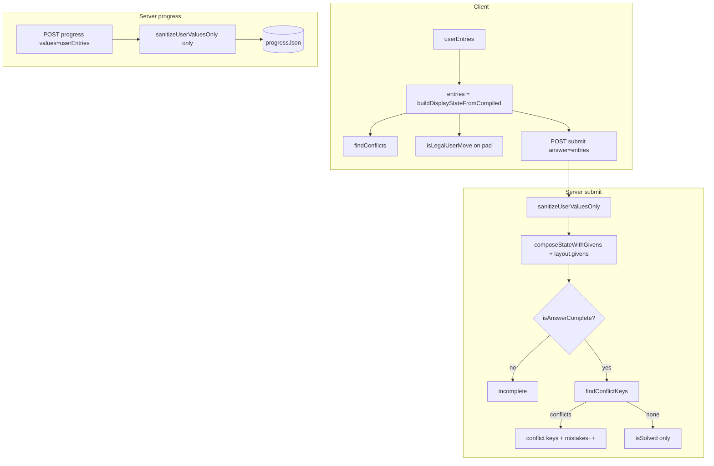
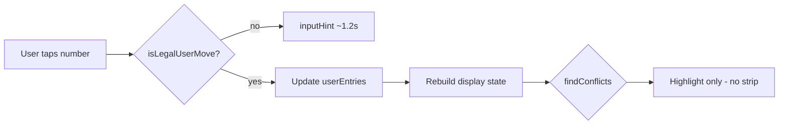

# ThinkGrid — Đặc tả kỹ thuật (Daily Logic Puzzle / One-Up style)

**Phiên bản tài liệu:** 1.6 — UX v1.6, Mức 2 gen, 54 tests, expert handoff (2026-05-25).  
**Đối tượng đọc:** reviewer kỹ thuật, maintainer backend/frontend, author puzzle.  
**Mã nguồn tham chiếu:** `src/lib/puzzle/*`, `src/services/puzzleService.ts`, `prisma/schema.prisma`.  
**Checklist triển khai:** [`thinkgrid-production-checklist.md`](./thinkgrid-production-checklist.md).  
**Gửi chuyên gia:** [`thinkgrid-expert-handoff.md`](./thinkgrid-expert-handoff.md) → [`thinkgrid-expert-review.md`](./thinkgrid-expert-review.md).

### Lịch sử thay đổi tài liệu

| Phiên bản | Nội dung |
|-----------|----------|
| 1.0 | Refactor pipeline validation: `statePipeline.ts`, tách 5 lớp validation |
| 1.1 | Expert review: sửa wording sanitize; submit không leak solution; seed solver-gated; `inputHint`; `sanitizeNotesOnly`; bảng đánh giá production; §17 |
| 1.2 | Seed dev/future tách; `THINKGRID_ALLOW_DATE_OVERRIDE`; `layoutQuality`; prune givens; submit invariant log |
| 1.3 | Today 7×7 HARD; `getApiUser` id guard; Start API 401/503; `db:puzzle:check`; UX idle/Start; verification 41 tests |
| 1.5 | Mức 2 gen: shuffle givens, quality gate, difficulty score; 49 tests |
| 1.6 | UX v1.6 P0 ship; Mức 2 gen; 54 tests; [`thinkgrid-expert-handoff.md`](./thinkgrid-expert-handoff.md) |

### Đánh giá nhanh (expert review)

| Hạng mục | Điểm | Ghi chú |
|----------|------|---------|
| Engine architecture | **8.5/10** | Segment, `min(H,V)`, solver MRV, publish gate |
| State pipeline | **8.5/10** | 3 invariant P0; **54 tests** |
| Puzzle content / seed | **7/10** | Mức 2: shuffle + quality gate + difficulty warn |
| Player UX | **8/10** | How-to-play, domain hint, solved modal, mobile pad |
| Production readiness (beta) | **7.5/10** | Handoff + checklist; thiếu Playwright |

---

## Mục lục

1. [Tổng quan sản phẩm & luật chơi](#1-tổng-quan-sản-phẩm--luật-chơi)
2. [Mô hình dữ liệu layout](#2-mô-hình-dữ-liệu-layout)
3. [Pipeline biên dịch (compile → CellMeta)](#3-pipeline-biên-dịch-compile--cellmeta)
4. [Năm lớp validation](#4-năm-lớp-validation)
5. [Thuật toán build segment](#5-thuật-toán-build-segment)
6. [Candidates, isLegalUserMove, isValueConsistentInState](#6-candidates-islegalusermove-isvalueconsistentinstate)
7. [Solver (MRV, countSolutions, publish gate)](#7-solver-mrv-countsolutions-publish-gate)
8. [State pipeline client/server](#8-state-pipeline-clientserver)
9. [API endpoints & response shapes](#9-api-endpoints--response-shapes)
10. [DB schema, streak, leaderboard](#10-db-schema-streak-leaderboard)
11. [Admin editor](#11-admin-editor)
12. [Seed strategy](#12-seed-strategy)
13. [Test coverage map](#13-test-coverage-map)
14. [Known limitations & design decisions](#14-known-limitations--design-decisions)
15. [Checklist review cho chuyên gia](#15-checklist-review-cho-chuyên-gia)
16. [Roadmap E2E (Playwright)](#16-roadmap-e2e-playwright--chưa-implement)
17. [Expert review — thay đổi đã áp dụng](#17-expert-review--thay-đổi-đã-áp-dụng)
18. [Production verification](#18-production-verification)
19. [Phụ lục A — File map](#phụ-lục-a--file-map)
20. [Phụ lục B — Ba invariant](#phụ-lục-b--xác-minh-ba-invariant-post-fix)

---

## 1. Tổng quan sản phẩm & luật chơi

### 1.1 ThinkGrid là gì?

**ThinkGrid** là trò chơi logic **một puzzle mỗi ngày** (timezone `Asia/Ho_Chi_Minh`), lấy cảm hứng từ **One-Up** / các “segment puzzle” — **không phải Sudoku**.

- Lưới vuông `size × size` (3–9), một số ô **đen (blocked)** không chơi được.
- **Tường (walls)** chia lưới thành các **segment** ngang (H) và dọc (V).
- Mỗi segment độ dài `L` chứa đúng các số **1..L**, **không trùng trong cùng segment**.
- Ràng buộc **theo segment**, không theo cả hàng/cột toàn bộ: cùng một hàng có thể có hai số `3` nếu chúng nằm ở **hai segment H khác nhau** (ngăn cách bởi tường dọc).

### 1.2 Luật chơi (player-facing)

| Khái niệm | Mô tả |
|-----------|--------|
| **Segment H** | Chuỗi ô liên tiếp trên cùng một hàng, không qua blocked, dừng khi gặp tường dọc giữa hai cột hoặc blocked |
| **Segment V** | Chuỗi ô liên tiếp trên cùng một cột, không qua blocked, dừng khi gặp tường ngang giữa hai hàng hoặc blocked |
| **Domain ô** | Giá trị hợp lệ: `1 .. maxAllowedValue`, với `maxAllowedValue = min(L_H, L_V)` của hai segment giao nhau tại ô |
| **Given** | Ô cố định từ layout; người chơi không sửa |
| **Conflict (UI)** | Giá trị đã đặt **không nhất quán** với segment/domain/given (highlight, không xóa khi autosave) |
| **Legal move (input)** | Chỉ khi ô editable và giá trị nằm trong **candidates** tại thời điểm đó |
| **Hoàn thành (submit)** | Mọi ô playable có số; không conflict; server `isSolved(state)` sau `composeStateWithGivens` — **không** so sánh `solutionJson` với client (tránh leak đáp án) |

### 1.3 Khác Sudoku (cố ý)

```
Sudoku:     uniqueness trong CẢ HÀNG và CẢ CỘT
ThinkGrid:  uniqueness trong từng SEGMENT H và SEGMENT V (độ dài biến thiên)
```

**Ví dụ có tường (seed day1 / day4 — quadrants):** tường giữa chia hàng thành hai segment H; cùng một hàng có thể chứa `1,2` và `1,2` ở hai nửa (unit test `puzzleEngine.test.ts` case 3 dùng layout 6×6 tường tại cột 3).

**Today (2026-05-25):** **7×7** với 3 ô blocked — khó hơn 4×4 quadrants; segment đa dạng hơn nhờ ô chết giữa/chéo.

**Lưu ý seed thực tế:** Nhiều layout “một hàng có tường dọc” trên 5×5 **không có nghiệm** khi chạy `findFirstSolution` (đã thử khi chỉnh seed). Seed hiện dùng quadrants (có tường) hoặc **blocked cells** (cắt segment) — xem §12.

---

## 2. Mô hình dữ liệu layout

### 2.1 Type `DailyPuzzleLayout` (`src/types/puzzle.ts`)

```ts
interface DailyPuzzleLayout {
  size: number;                    // 3..9
  blocked: boolean[][];          // size × size
  verticalWalls: boolean[][];    // size × (size+1)
  horizontalWalls: boolean[][];  // (size+1) × size
  givens: Record<string, number>; // key "row,col"
}
```

### 2.2 Semantics ma trận tường

**Ô playable** tại `(r, c)` (0-indexed). Tường **ngoài** luôn `true` (enforced bởi `ensureOuterWalls` / `validateLayout`).

#### `verticalWalls[r][c]` — tường **cạnh trái** của ô `(r,c)`

```
     c=0    c=1    c=2
r=0  |█| □ |█| □ □
      ^vw[r][0]  ^vw[r][2] giữa (r,0)-(r,1)
```

- `verticalWalls[r][0] === true` → biên trái lưới (outer).
- `verticalWalls[r][size] === true` → biên phải lưới (outer).
- **Tường giữa** `(r,c)` và `(r,c+1)`: `hasVerticalWallBetween` → `verticalWalls[r][c+1] === true` (alias `hasWallRight`).

#### `horizontalWalls[r][c]` — tường **cạnh trên** của ô `(r,c)`

```
r=0  ███████  ← horizontalWalls[0][*] (top outer)
r=1  □ □ □
     ───      ← horizontalWalls[2][c] giữa (1,c)-(2,c)
```

- **Tường giữa** `(r,c)` và `(r+1,c)`: `horizontalWalls[r+1][c] === true` (`hasWallBottom`).

#### `blocked[r][c]`

- `true` → ô không playable, không có segment, không có givens hợp lệ.

### 2.3 Bảng ánh xạ API ↔ hình học

| Hàm (`layoutUtils.ts`) | Ý nghĩa |
|------------------------|---------|
| `hasWallLeft(r,c)` | `verticalWalls[r][c]` |
| `hasWallRight(r,c)` | `verticalWalls[r][c+1]` |
| `hasWallTop(r,c)` | `horizontalWalls[r][c]` |
| `hasWallBottom(r,c)` | `horizontalWalls[r+1][c]` |
| `hasVerticalWallBetween(r,c,c+1)` | tường giữa hai ô cùng hàng |
| `hasHorizontalWallBetween(r,r+1,c)` | tường giữa hai ô cùng cột |

### 2.4 Cell key

- Format: `"row,col"` (`cellKey`, `parseCellKey`).
- `PuzzleSolution` / `PuzzleState`: `Record<string, number>` hoặc `number | null | undefined` cho state đang chơi.

### 2.5 Legacy layout

`normalizeLayout` (`layoutUtils.ts`) chuyển `{ blockedCells, walls.right/bottom }` sang ma trận mới; mọi đường đọc DB/API đi qua `parseLayoutJson` → `normalizeLayout`.

### 2.6 Compiled artifacts (`CompiledPuzzle`)

Sau `compilePuzzle(layout)`:

| Field | Mô tả |
|-------|--------|
| `cells[][]` | `CellMeta` mỗi ô |
| `horizontalSegments` / `verticalSegments` | Danh sách segment |
| `cellToHorizontalSegment` / `cellToVerticalSegment` | Map key → segment id |
| `segmentById` | Tra cứu nhanh |
| `playableKeys` | Mọi key không blocked |

**`CellMeta` quan trọng:**

- `hSegmentId`, `vSegmentId`, `hSegmentLength`, `vSegmentLength`
- `maxAllowedValue = min(hSegmentLength, vSegmentLength)` khi ô playable và có đủ hai segment
- `isGiven`, `givenValue` từ `layout.givens[key]`

---

## 3. Pipeline biên dịch (compile → CellMeta)

**File:** `src/lib/puzzle/compiler.ts`

```
layout (JSON/DB)
    → buildHorizontalSegments(layout)
    → buildVerticalSegments(layout)
    → segmentById
    → duyệt từng (r,c): CellMeta + playableKeys
    → CompiledPuzzle
```

`maxAllowedValue` chỉ set khi **cả** `hSegmentLength` và `vSegmentLength` đã xác định (ô nằm trong cả segment H và V).

`getCellMeta(compiled, key)` parse `"r,c"` và index `compiled.cells[r][c]`.

---

## 4. Năm lớp validation

Thiết kế sau expert review: **tách rõ** “cấu trúc puzzle”, “miền giá trị”, “quyền sửa”, “nhất quán state”, “hoàn thành / publish”. Không dùng `isLegalUserMove` cho sanitize/conflict/givens.

### 4.1 Tổng quan

| Lớp | Tên | Hàm chính | Khi dùng |
|-----|-----|-----------|----------|
| **1** | Structural | `validateLayout` | Admin/import, trước compile; publish gate |
| **2** | Domain | `isValueInCellDomain`, `maxAllowedValue` (compile) | Consistency, full solution check |
| **3** | Editability | `isEditableCell`, `sanitizeUserValuesOnly` | Client input filter, progress save, submit sanitize |
| **4** | Consistency | `isValueConsistentInState`, `findConflictKeys` | UI conflict highlight, submit reject conflict |
| **5** | Completion | `isCompleteValidSegment`, `isSolved`, `isAnswerComplete`, `validateFullSolution` | Submit flow, admin solution, publish |

**Publish gate bổ sung** (không thay thế lớp 1–5): `validateGivens`, `validatePuzzleForPublish` + `countSolutions` (unique).

### 4.2 Lớp 1 — Structural (`validator.ts`)

`validateLayout(layout)`:

- `size` integer 3..9
- Kích thước ma trận `blocked`, `verticalWalls`, `horizontalWalls` đúng
- Outer walls: `verticalWalls[r][0]`, `[r][size]`, `horizontalWalls[0][c]`, `[size][c]` đều `true`
- Mỗi key trong `givens`: parse được, không nằm trên blocked

**Không** kiểm tra uniqueness puzzle hay segment fill — chỉ schema hình học.

### 4.3 Lớp 2 — Domain

`isValueInCellDomain(cell, value)` (`statePipeline.ts`):

- Integer `value >= 1`
- `cell.maxAllowedValue` tồn tại và `value <= maxAllowedValue`

Dùng bên trong `isValueConsistentInState` cho ô **không** given.

`validateGivens(compiled)` (admin/publish): mỗi given trong range và **không trùng** trong cùng segment H hoặc V.

### 4.4 Lớp 3 — Editability

`isEditableCell(cell)`: `!isBlocked && !isGiven`.

`sanitizeUserValuesOnly(raw, compiled)`:

- **Chỉ persist ô người chơi tự điền:** given và blocked keys **bị bỏ qua / không lưu** vào `progressJson`.
- Givens được **áp lại sau** qua `composeStateWithGivens` / `buildDisplayStateFromCompiled` (server và client).
- Giữ entry user khi: key playable, `isEditableCell`, integer trong `[1, size]`.
- **Không** xóa entry vì segment conflict (conflict để UI hiển thị, không silent-delete).

`sanitizeNotesOnly(raw, compiled)` (progress API):

- Bỏ notes trên given/blocked; tối đa 9 số/ô, tối đa 64 ô có notes (chống payload quá lớn).

### 4.5 Lớp 4 — Consistency

`isValueConsistentInState(state, cellMeta, value, compiled)`:

| Điều kiện | Hành vi |
|-----------|---------|
| Blocked | `false` |
| Given | `true` chỉ khi `value === cellMeta.givenValue` (**given không bao giờ là conflict**) |
| Non-given | Domain + có segment H/V + không trùng `value` trong segment H và V (trừ chính ô) |

`findConflictKeys` / `findConflicts`: duyệt `playableKeys`, mọi ô có giá trị mà `!isValueConsistentInState` → conflict.

`hasLocalConflicts`: convenience boolean.

### 4.6 Lớp 5 — Completion

`isCompleteValidSegment(state, segment)`:

- Mọi ô segment có giá trị
- Tập giá trị = `{1..L}` đúng `L = segment.length`

`isSolved(state, compiled)`:

- Mọi playable key có giá trị
- Given khớp state
- Mọi segment H và V: `isCompleteValidSegment`

`isAnswerComplete(state, compiled)`: mọi playable có integer `>= 1` (chưa cần đúng permutation).

`validateFullSolution(solution, layout)`:

- `validateLayout` → compile → `validateGivens`
- Mọi playable có số trong solution; không key trên blocked
- `isSolved(solution, compiled)`
- `solution[key] === layout.givens[key]` cho mọi given

### 4.7 Ma trận “hàm nào cho việc gì” (runtime player)

| Tác vụ | Hàm |
|--------|-----|
| Chặn nhập số trên pad | `isLegalUserMove` |
| Tô đỏ ô sai | `findConflicts` trên **display state** |
| Autosave DB | `sanitizeUserValuesOnly` only |
| Submit server | `sanitizeUserValuesOnly` → `composeStateWithGivens` → `isAnswerComplete` → `findConflictKeys` → `isSolved` (không trả `wrongCells` so với `solutionJson`) |
| Admin validate nút | `validatePuzzleForPublish` |

### 4.8 Re-export

`validator.ts` re-export toàn bộ state pipeline helpers để import một chỗ từ service/UI.

---

## 5. Thuật toán build segment

**File:** `src/lib/puzzle/segments.ts`

### 5.1 Segment ngang `buildHorizontalSegments`

Pseudo-code:

```
segments = []
for r in 0..size-1:
  c = 0
  while c < size:
    if blocked(r,c): c++; continue
    cells = []
    while c < size and not blocked(r,c):
      cells.append((r,c))
      if c == size-1: break
      if wall_vertical_between(r,c,c+1) OR blocked(r,c+1): break
      c++
    push Segment(id=H-{n}, direction=H, cells, length=len(cells))
    map each cell key → segment id
    c++
return segments, cellToSegmentId
```

### 5.2 Segment dọc `buildVerticalSegments`

Tương tự theo cột `c`, tăng `r`, dừng tại `hasHorizontalWallBetween` hoặc blocked phía dưới.

### 5.3 Hệ quả thiết kế

- Tường **dọc** chỉ ảnh hưởng segment **H** (test 7, 8).
- Tường **ngang** chỉ ảnh hưởng segment **V** (test 9).
- Ô blocked **cắt** segment trên cùng hàng/cột (test 6).

ID segment: `H-0`, `H-1`, … và `V-0`, `V-1`, … theo thứ tự quét.

---

## 6. Candidates, isLegalUserMove, isValueConsistentInState

### 6.1 `getCandidates` (`candidates.ts`)

Cho ô editable, có segment H/V:

```
candidates = []
for value in 1..maxAllowedValue:
  if not segmentContainsValue(H, value, except=this.key)
     and not segmentContainsValue(V, value, except=this.key):
    candidates.append(value)
```

Blocked/given → `[]`.

### 6.2 `isLegalUserMove` vs `isValueConsistentInState`

| | `isLegalUserMove` | `isValueConsistentInState` |
|--|-------------------|----------------------------|
| **Mục đích** | Cho phép **nhập mới** | Đánh giá giá trị **đã có** trên bảng |
| Editable | Bắt buộc | Given: chỉ khớp `givenValue` |
| Điều kiện | `getCandidates(...).includes(value)` | Domain + không trùng segment (hoặc given rule) |
| Conflict 1-1 cùng segment | Không cho nhập | Ô **cả hai** có thể conflict highlight |

**Ví dụ:** state `{'0,0':1,'0,1':1}` — `0,1` không legal move thêm `1`, nhưng nếu user đã có cả hai (từ progress cũ), `findConflictKeys` trả về cả hai; `sanitizeUserValuesOnly` **giữ** cả hai.

### 6.3 `isLegalMove`

Alias deprecated → `isLegalUserMove`.

---

## 7. Solver (MRV, countSolutions, publish gate)

**File:** `src/lib/puzzle/solver.ts`, `puzzleValidation.ts`

### 7.1 Chiến lược

- **MRV** (Minimum Remaining Values): chọn ô trống có ít `getCandidates` nhất (`findEmptyCellWithFewestCandidates`).
- Nhánh: thử từng candidate; dùng `isLegalUserMove` khi gán (đồng bộ với player).
- `isSolved` là điều kiện dừng đúng.

### 7.2 `countSolutions(compiled, initialState?, limit=2)`

- `initialState` mặc định: chỉ givens (`buildInitialState(..., givensOnly=true)`).
- Đếm đến `limit` (2) để phát hiện 0 / 1 / nhiều nghiệm.
- `hasUniqueSolution` ⇔ `count === 1`.

### 7.3 `findFirstSolution`

DFS tìm **một** nghiệm đầy đủ — dùng seed (`puzzle-seed-data.ts`) và admin tooling.

### 7.4 Publish gate — `validatePuzzleForPublish`

Thứ tự (`puzzleValidation.ts`):

1. `validateLayout`
2. `compilePuzzle` → `validateGivens`
3. `validateFullSolution(solution, layout)`
4. `countSolutions(compiled, undefined, 2)` — phải đúng **1**

Gọi từ:

- `validatePuzzleFromJson`
- `createPuzzleAdmin` / `updatePuzzleAdmin` khi status `VALIDATED` / `PUBLISHED`
- `POST /api/admin/puzzles/[id]/validate`
- Admin create với status VALIDATED/PUBLISHED

---

## 8. State pipeline client/server

**File:** `statePipeline.ts`, `useDailyPuzzleSession.ts`, `puzzleService.ts`

### 8.1 Hai lớp state

| Biến | Ý nghĩa | Lưu DB/local |
|------|---------|--------------|
| `userEntries` | Chỉ số người chơi tự điền | `progressJson`, localStorage draft |
| `entries` (display) | `buildDisplayStateFromCompiled(userEntries)` = sanitize user + **overlay givens** | UI, submit body |

```ts
buildDisplayStateFromCompiled(userValues, compiled) {
  const clean = sanitizeUserValuesOnly(userValues, compiled);
  return composeStateWithGivens(clean, compiled.layout.givens);
}
// composeStateWithGivens: { ...userValues, ...givens }  → givens WIN
```

### 8.2 Givens không phải conflict

`findConflicts(entries, compiled)` với display state: given luôn `isValueConsistentInState` khi value = `givenValue` (test `statePipeline.test.ts`).

### 8.3 Client input (blocking mode — hướng B cho MVP)

| Kênh | Quy tắc |
|------|---------|
| **Number pad** | Ẩn số `> maxAllowedValue`; **disable** nút không nằm trong `candidates` |
| **Keyboard** | Chỉ `1..maxAllowedValue`; nhập giá trị chỉ khi `candidates.includes(n)` (cùng rule pad) |
| **`setValue`** | Gọi `isLegalUserMove(entries, cell, value, compiled)` trên **display state** (đã overlay givens); nếu false → **không ghi** + `inputHint` ~1.2s |

`inputHint` dùng `describeIllegalUserMove` (tiếng Việt: trùng đoạn ngang/dọc, ngoài phạm vi 1..L). Khi chặn nhập: `rejectPulse` → rung nhẹ ô chọn + pad; pad số **không hợp lệ** vẫn bấm được (mờ) để hiện hint, không `disabled`.

**Ghi chú (notes):** Nút «Ghi chú» (icon bút); bật thì pad toggle pencil marks (tối đa 9/ô, ≤ `maxAllowedValue`); số đã ghi chú được highlight trên pad; đặt số vào ô xóa notes ô đó; ô có số không hiện notes. **Xóa:** nút tẩy (value + notes), Backspace tương đương.

**Conflict vs chặn nhập:** `candidates` / pad mờ = không đặt *ngay*; sau khi đặt, `findConflictKeys` → viền đỏ ô conflict + tint nhạt cả đoạn liên quan. Ô chọn: ring accent; đoạn cùng H/V và cùng số: highlight nhẹ.

**Không dùng** `isLegalMove` / `isLegalUserMove` cho conflict detection hay sanitize — xem §4.

**Clear/delete:** `setValue(null)`, `clearCell`, Backspace — **không** qua `isLegalUserMove`; chỉ khi `phase === 'playing'`.

### 8.3.1 Phase `idle` vs `playing` (v1.3)

| Phase | UI | Input |
|-------|-----|-------|
| `idle` | Xem board + given; banner «Bắt đầu chơi» | Không pad; click ô editable → `inputHint` Start |
| `playing` | Timer chạy; pad + keyboard | `POST /api/puzzle/attempt/start` đã tạo attempt |
| `solved` | Share + leaderboard | Read-only |

`POST /api/puzzle/attempt/start?date=` — optional khi date override staging.

### 8.3.2 Undo (Ctrl+Z / ⌘Z) — v1.4

**Files:** `undoStack.ts`, `useDailyPuzzleSession.ts`, `PuzzleGame.tsx`

| Hành vi | Chi tiết |
|---------|----------|
| Khi nào push | Trước mỗi `setValue`, `toggleNote`, `clearCell` (snapshot `userEntries` + `notes`) |
| Độ sâu | Tối đa **80** bước; bỏ qua snapshot trùng liên tiếp |
| Khi nào clear | `reload`, `startGame` |
| Phím | `Ctrl+Z` / `⌘Z` khi `phase === 'playing'` |
| Redo | Không có (chỉ hoàn tác một chiều) |

Chi tiết pipeline sinh puzzle + câu hỏi reviewer: [`thinkgrid-expert-review.md`](./thinkgrid-expert-review.md).

### 8.3.3 Player UX v1.5 (P0)

Checklist đầy đủ: [`thinkgrid-ux-plan.md`](./thinkgrid-ux-plan.md). Tóm tắt:

- `HowToPlayModal` — 4 bước, auto-open lần đầu, nút «Cách chơi».
- Board: tường 4–5px; selected sky (≠ conflict đỏ); segment tint amber; conflict `!`.
- `CellDomainHint`, `SaveStatusBadge`, `PuzzleSolvedModal` (time, streak, rank, share).
- Mobile: tab Chơi / Xếp hạng / Thống kê; pad + Nộp sticky đáy.
- `trySubmit` — báo còn N ô / conflict trước API; `mapStartErrorMessage` cho Start.
- Phím: mũi tên, `N` notes, Ctrl+Z + nút Hoàn tác.

### 8.4 Autosave progress

- Debounce 1.5s → `POST /api/puzzle/attempt/progress` với **`values: userEntries`**, **`notes`** (optional).
- Server `saveProgress`:
  - `progressJson` ← `sanitizeUserValuesOnly(values)` — **chỉ ô editable**, không given/blocked keys.
  - `notesJson` ← `sanitizeNotesOnly(notes)` — bỏ given/blocked; tối đa 9 số/ô, 64 ô có notes.
- localStorage mirror: `thinkgrid-draft-{puzzleId}-{dateKey}` (cùng shape).

**Merge khi load (givens thắng):**

```ts
userEntries = sanitizeUserValuesOnly({ ...serverProgress, ...localDraft.entries })
display entries = buildDisplayStateFromCompiled(userEntries, compiled)
// givens từ layout.givens luôn đè lên progress/local sai
```

### 8.5 Submit flow (server authoritative)

`submitAttempt`:

```ts
userValues = sanitizeUserValuesOnly(answer, compiled);
state = composeStateWithGivens(userValues, layout.givens);
```

Dù client gửi `answer` kèm givens hay cố ghi đè given — server **luôn** overlay lại `layout.givens`.

Pipeline kiểm tra:

1. `MIN_SUBMIT_DURATION_MS` (3000ms)
2. `isAnswerComplete(state)` → `incomplete: true`
3. `findConflictKeys(state)` → mistake++, `hasConflict: true`, `wrongCells: conflictKeys`
4. `isSolved(state)` → nếu true: **correct** (puzzle đã publish qua unique gate → nghiệm segment đúng là duy nhất).
5. Nếu không solved: `correct: false`, **`wrongCells: []`**, `mistakes++` — **không** gọi `compareAnswerToSolution`; server log `complete_no_conflict_but_not_solved` (invariant breach — hiếm).
6. Correct → SOLVED, leaderboard (lần đầu), streak, share text.

**Clear ô:** `setValue(null)` / `clearCell` / Backspace **không** qua `isLegalUserMove` — luôn xóa được ô editable.

**Lý do bỏ nhánh `compareAnswerToSolution` trên player submit:** Với state complete + không conflict, mỗi segment đã là permutation `{1..L}`; nếu puzzle có đúng 1 nghiệm thì `isSolved` đủ. Hàm `compareAnswerToSolution` vẫn tồn tại trong `validator.ts` cho admin/debug nếu cần sau này.

### 8.6 Diagram — vòng đời state



### 8.7 Diagram — phân tách validation khi chơi



---

## 9. API endpoints & response shapes

Chuẩn response (`src/lib/apiUtils.ts`):

```json
{ "ok": true, "data": { ... } }
{ "ok": false, "error": "message" }
```

### 9.1 Public puzzle

| Method | Path | Auth | Mô tả |
|--------|------|------|-------|
| GET | `/api/puzzle/today` | Optional | Puzzle theo ngày + attempt + stats. Query `?date=YYYY-MM-DD` khi `THINKGRID_ALLOW_DATE_OVERRIDE=true` |

**Success `data`:**

```ts
{
  puzzle: DailyPuzzlePublic;  // layout KHÔNG có solution
  attempt?: PuzzleAttemptPublic;
  stats?: PuzzleStatsPublic;
}
```

`DailyPuzzlePublic`: `id`, `dateKey`, `title`, `size`, `layout`, `difficulty`.

### 9.2 Attempt

| Method | Path | Auth | Body | Success `data` |
|--------|------|------|------|----------------|
| POST | `/api/puzzle/attempt/start` | Yes | Query `?date=` (override) | `{ attempt, puzzleId }` |
| POST | `/api/puzzle/attempt/progress` | Yes | `{ puzzleId, values, notes? }` | `{ values }` sau `sanitizeUserValuesOnly` (không có key given) |
| POST | `/api/puzzle/attempt/submit` | Yes | `{ puzzleId, answer }` | Submit result (below) |

**Submit result shapes:**

```ts
// Correct
{ correct: true, durationMs, mistakes, attempt, stats, shareText, wrongCells: [], incomplete: false }

// Incomplete board
{ correct: false, wrongCells: [], incomplete: true }

// Segment/domain conflict (ô user conflict — không leak solution)
{ correct: false, wrongCells: string[], incomplete: false, hasConflict: true }
// wrongCells = conflictKeys (ô vi phạm segment/domain), không phải so solutionJson

// Wrong solution: board đủ ô, không conflict, nhưng isSolved = false
{ correct: false, wrongCells: [], incomplete: false }
// mistakes++; không trả danh sách ô sai theo đáp án

// Errors (HTTP)
409 Already solved | 422 Submit too fast | 400 No active attempt
```

**Start (`POST /api/puzzle/attempt/start`) — lỗi thường gặp:**

| HTTP | `error` / nguyên nhân | Xử lý |
|------|------------------------|--------|
| 401 | Unauthorized | Đăng nhập |
| 401 | Phiên đăng nhập không hợp lệ | `session.user.id` thiếu — đăng xuất/đăng nhập lại (`getApiUser`) |
| 503 | Database schema outdated | `npm run db:migrate:deploy` (thiếu `progressJson`, `eligibleForLeaderboard`, …) |
| 404 | No puzzle published for {dateKey} | Seed / publish puzzle |
| 500 | Internal server error | Xem server log; thường Prisma chưa migrate |

### 9.3 Leaderboard & stats

| Method | Path | Query | `data` |
|--------|------|-------|--------|
| GET | `/api/puzzle/leaderboard` | `date`, `limit` (≤50) | `{ dateKey, entries: LeaderboardEntryPublic[] }` |
| GET | `/api/puzzle/stats` | — | `{ stats, todayAttempt }` |

`LeaderboardEntryPublic`: `rank`, `userId`, `userName`, `durationMs`, `mistakes`, `submittedAt`.

### 9.4 Admin (`withAdmin`)

| Method | Path | Ghi chú |
|--------|------|---------|
| GET | `/api/admin/puzzles` | List 50 mới nhất |
| POST | `/api/admin/puzzles` | Create; validate nếu VALIDATED/PUBLISHED |
| GET | `/api/admin/puzzles/[id]` | Full layoutJson + solutionJson |
| PATCH | `/api/admin/puzzles/[id]` | Update; publish yêu cầu VALIDATED trước |
| POST | `/api/admin/puzzles/[id]/validate` | Solver gate; set status VALIDATED nếu ok |

Validate response:

```ts
{ valid: boolean, errors: string[], solutionCount?: number }
```

---

## 10. DB schema, streak, leaderboard

### 10.1 Prisma models (`prisma/schema.prisma`)

**`DailyPuzzle`**

| Field | Ghi chú |
|-------|---------|
| `dateKey` | Unique `YYYY-MM-DD` (Asia/Ho_Chi_Minh) |
| `layoutJson` / `solutionJson` | Json |
| `status` | `DRAFT` → `VALIDATED` → `PUBLISHED` / `ARCHIVED` |
| `difficulty` | EASY / MEDIUM / HARD |

**`PuzzleAttempt`**

- Unique `(userId, puzzleId)`
- `progressJson`, `notesJson` — chỉ user-editable content (sau sanitize)
- `status`: IN_PROGRESS | SOLVED | FAILED | ABANDONED
- `mistakes`, `durationMs`, `eligibleForLeaderboard`

**`PuzzleLeaderboardEntry`**

- Unique `(userId, puzzleId)` — **một entry / user / puzzle**
- `rankScore = durationMs + mistakes * 30_000` (`MISTAKE_RANK_PENALTY_MS`)
- Sort ascending `rankScore`

**`PuzzleUserStats`**

- `currentStreak`, `longestStreak`, `lastSolvedDateKey`, `totalSolved`

### 10.2 Streak rules (`puzzleStreakService.ts`)

- Timezone puzzle: `getPuzzleDateKey()` = calendar day VN.
- Sau solve đúng: `updatePuzzleStreak(userId, puzzle.dateKey)`.
- **Idempotent:** nếu `lastSolvedDateKey === solvedDateKey` → không tăng lại.
- Streak tiếp nối khi `lastSolvedDateKey === getPreviousDateKey(solvedDateKey)`; ngược lại reset về 1.
- `todaySolved` = `lastSolvedDateKey === todayKey`.

### 10.3 Leaderboard eligibility (`submitAttempt`)

- Chỉ tạo `PuzzleLeaderboardEntry` nếu **chưa có** entry cho `(userId, puzzleId)`.
- `eligibleForLeaderboard` trên attempt phản ánh lần đầu; resubmit sau solve không thay leaderboard (attempt đã SOLVED).

### 10.4 `startAttempt`

- SOLVED → return existing (không reset).
- IN_PROGRESS → return existing.
- Khác → upsert IN_PROGRESS, reset timer fields nếu tạo lại từ abandoned.

---

## 11. Admin editor

**Components:** `PuzzleEditor.tsx`, `EditorBoard.tsx`

### 11.1 Editor modes (`EditorMode`)

| Mode | Tương tác |
|------|-----------|
| `walls` | Click cạnh dọc/ngang toggle `verticalWalls` / `horizontalWalls`; outer walls preserved |
| `blocked` | Toggle `blocked[r][c]` |
| `solution` | Chọn ô + number pad ghi `solution[key]` |
| `givens` | Toggle given từ ô đã có trong solution (không given trên ô chưa có solution) |

### 11.2 Live validation sidebar

- `validateLayout`, `validateGivens`, `validateFullSolution` (client-side)
- Nút **Validate (Solver)** → `POST .../validate` → `validatePuzzleForPublish` + set VALIDATED
- **Publish** chỉ khi `status === VALIDATED`

### 11.3 Workflow status

```
DRAFT → (validate API) → VALIDATED → (PATCH publish) → PUBLISHED
```

`updatePuzzleAdmin`: chuyển PUBLISHED từ DRAFT bị chặn nếu chưa VALIDATED (trừ đã PUBLISHED).

---

## 12. Seed strategy

**File:** `prisma/puzzle-seed-data.ts`

### 12.1 Quy trình mỗi ngày

1. `createEmptyLayout(size)` + bật walls/blocked theo recipe ngày.
2. `layout.givens = {}` → `findFirstSolution(compiled)` — nếu không có nghiệm → throw.
3. `pickGivensForUnique(layout, solution, { seedKey: dateKey })` — shuffle deterministic → greedy → prune (`givenPicker.ts`).
4. `validatePuzzleForPublish` — unique + **layout quality errors** + difficulty warnings.
5. Export `SEED_PUZZLES` (7 ngày mẫu 2026-05-19 … 2026-05-25).

### 12.2 Ý đồ từng ngày (walls per day)

| dateKey | Đặc điểm layout |
|---------|-----------------|
| 2026-05-19 | 4×4: tường giữa chia 4 quadrant 2×2 — demo duplicate cross-segment trên hàng |
| 2026-05-20 | 5×5: blocked `(1,3)` |
| 2026-05-21 | 5×5: ô giữa blocked `(2,2)` |
| 2026-05-22 | 6×6: quadrants 3×3 |
| 2026-05-23 | 5×5: blocked góc `(0,4)`, `(4,0)` |
| 2026-05-24 | 5×5: blocked `(2,2)`, `(3,1)` |
| 2026-05-25 | **7×7** HARD: blocked `(3,3)`, `(1,5)`, `(5,1)` — ~9 givens sau prune |

### 12.3 Puzzle authoring pitfalls

Không phải layout có tường đều tạo puzzle hay hoặc có nghiệm.

**Mâu thuẫn kinh điển (vô nghiệm):**

- Nhiều **horizontal segment dài 1** trên cùng một **vertical segment dài L > 1**.
- Mỗi ô trong segment H dài 1 bắt buộc giá trị `1`.
- Cột (segment V dài L) lại cần `{1..L}` không trùng → **không thể** nếu không có tường ngang cắt cột thành segment V ngắn hơn.

**Quy tắc thực hành:**

1. Mỗi segment dài `L` phải có thể chứa permutation `{1..L}`; mọi ô trong segment có `maxAllowedValue = min(hLen, vLen)`.
2. Tránh tạo quá nhiều segment dài 1 cắt ngang một segment dọc dài.
3. Luôn chạy `findFirstSolution` + `hasUniqueSolution` trước publish (seed và admin validate).
4. `pickGivensForUnique`: greedy thêm given → **prune** given thừa vẫn unique (v1.2).

### 12.4 Layout đã thử và **không** dùng trong seed (solver = 0 nghiệm)

Khi chỉnh seed, các pattern sau **fail** `findFirstSolution` (không insert):

| Pattern | Kết quả |
|---------|---------|
| 5×5 `verticalWalls[2][3]` (tường hàng 2 giữa cột 2–3) | No solution |
| 5×5 `verticalWalls[0][2]` (chỉ hàng 0 split) | No solution |
| 3×3 tường dọc full cột 1 (mọi hàng) | No solution — mâu thuẫn H=1 vs V=3 (§12.3) |

Author puzzle **bắt buộc** chạy solver sau mỗi chỉnh layout; không tin “nhìn có vẻ hợp lý”.

### 12.5 Seed runner & DB tools

| Lệnh | File | Mô tả |
|------|------|--------|
| `npm run db:seed:puzzle` | `puzzle-seed-future.ts` | Alias future (production-safe) |
| `npm run db:seed:puzzle:future` | `puzzle-seed-runner.ts` | Upsert; skip có attempts; **stale-replace** khi size/title lệch |
| `npm run db:seed:puzzle:dev` | `puzzle-seed.ts` | Wipe all — cần `PUZZLE_SEED_CONFIRM=WipeAll` |
| `npm run db:puzzle:check` | `puzzle-db-check.ts` | In bảng DB vs seed; flag TODAY MISMATCH |

- `SEED_PUZZLES = buildSeedPuzzles()` — throw nếu ngày không có nghiệm / không unique được.
- `assessLayoutQuality()` — **errors** chặn seed/publish; **warnings** khi authoring.
- `evaluateDifficulty()` — log score khi seed; warn nếu quá dễ / cần đoán.

### 12.6 Tests seed

- `seedPuzzles.test.ts` — 7 ngày × publish gate + quality + unique; day7 **7×7** + HARD.
- `seedShuffle`, `givenPicker`, `difficultyEvaluator` tests — Mức 2 generation.

---

## 13. Test coverage map

| File | Phạm vi |
|------|---------|
| `__tests__/puzzleEngine.test.ts` | `validateLayout`, segment build (tests 6–9), `isCompleteValidSegment` (1–4), row duplicate across segments (3), max candidates (5), `validateGivens` conflict (10), `isLegalMove`, `validateFullSolution` 3×3 |
| `__tests__/solver.test.ts` | 3×3 multiple solutions; full givens unique; conflicting givens → 0 solutions |
| `__tests__/statePipeline.test.ts` | **Given not conflict**; duplicate conflict; **sanitize keeps conflicts**; strip givens/blocked; **composeStateWithGivens**; **server submit path** with givens overlay; wall split; `isValueConsistentInState` on givens |
| `__tests__/seedPuzzles.test.ts` | 7 ngày publish gate + quality + unique; day7 = 7×7 |
| `__tests__/seedShuffle.test.ts`, `givenPicker.test.ts`, `difficultyEvaluator.test.ts` | Mức 2 generation |
| `__tests__/puzzleValidation.test.ts` | Publish gate + quality errors |
| `__tests__/undoStack.test.ts`, `playableStats.test.ts`, `startErrorMessage.test.ts` | UX/session helpers |
| `__tests__/puzzleDateOverride.test.ts` | `THINKGRID_ALLOW_DATE_OVERRIDE` + `?date=` |
| `__tests__/layoutQuality.test.ts` | Quality errors + warnings |
| `prisma/puzzle-db-check.ts` | CLI kiểm DB vs catalog (không phải vitest) |

Chạy:

```bash
npx vitest run src/lib/puzzle   # 54 tests (13 files) — chạy lệnh để lấy số thực tế
npm run db:puzzle:check
npm run build
```

**Verification 2026-05-25:** 54/54 pass (`src/lib/puzzle`), build exit 0. Chi tiết: [`thinkgrid-expert-handoff.md`](./thinkgrid-expert-handoff.md) §2.

### 13.1 Integration / E2E (chưa có)

Playwright **chưa** trong `package.json`. Kịch bản đề xuất: §16 và [`thinkgrid-production-checklist.md`](./thinkgrid-production-checklist.md).

---

## 14. Known limitations & design decisions

### 14.1 Cố ý (không phải bug)

1. **Segment-not-row model:** Không validate uniqueness whole-row; test `validateRowAllowsCrossSegmentDuplicates` document hành vi.
2. **Conflicts retained in progress:** UX hiển thị lỗi; user tự sửa; autosave không “sửa hộ”.
3. **Givens overlay server-side:** Client có thể gửi given trong `answer`; server `composeStateWithGivens` ghi đè — chống cheat/progress corrupt.
4. **Submit uses display-shaped answer:** Session gửi `entries` (đã merge givens); server vẫn tách sanitize user-only — hai lớp phòng thủ.
5. **Leaderboard one shot per puzzle:** Không cập nhật score nếu đã có entry.
6. **Mistake on conflict OR wrong solution:** Không mistake khi `incomplete`.
7. **Anti-cheat tối thiểu:** `MIN_SUBMIT_DURATION_MS` = 3s; không replay validation client cho submit.
8. **`isLegalMove` deprecated** nhưng tests cũ vẫn import tên cũ.

### 14.2 Hạn chế / chưa làm

- Không có puzzle archive browser cho người chơi (chỉ today + leaderboard theo date).
- `PuzzleAttemptStatus.FAILED/ABANDONED` ít dùng trong flow hiện tại.
- Notes: `sanitizeNotesOnly` cap size; chưa validate từng note theo `getCandidates`.
- Submit sai: **không** trả `wrongCells` so với `solutionJson` (chống leak); conflict submit vẫn có thể trả `conflictKeys`.
- Solver `validatePuzzleUnique` có dead code `void givensErr` — logic thực tế ở `puzzleValidation`.
- Admin **không** auto-generate solution từ solver trong UI (phải nhập solution mode hoặc seed script).
- Timezone streak dùng `getPreviousDateKey` UTC calendar math trên dateKey string — đủ cho ngày liên tiếp VN khi dateKey luôn từ `getPuzzleDateKey`.

### 14.3 Scoring & share

- `rankScore = durationMs + mistakes * 30_000`
- Share text: `ThinkGrid #n`, time, mistakes, streak, URL.

---

## 15. Checklist review cho chuyên gia

Dùng checklist sau khi đọc spec hoặc review PR:

### Luật & segment

- [ ] Xác nhận segment H/V build đúng với semantics `verticalWalls[r][c+1]` và `horizontalWalls[r+1][c]`.
- [ ] Case hàng dài bị tường chia: duplicate số giữa hai segment H **được phép**.
- [ ] `maxAllowedValue = min(L_H, L_V)` trên ô giao segment.

### Validation layers

- [ ] `validateLayout` / `validateGivens` / `validateFullSolution` / `countSolutions` trên publish.
- [ ] `sanitizeUserValuesOnly` **không** xóa conflict; **không** lưu given keys.
- [ ] `findConflictKeys` dùng `isValueConsistentInState`; **givens không** nằm trong conflict set khi đúng given.
- [ ] `isLegalUserMove` ⊂ consistent nhưng không thay thế conflict detection trên state hiện có.

### Client/server state

- [ ] `userEntries` vs `entries` (display) tách bạch trong `useDailyPuzzleSession`.
- [ ] Progress API chỉ persist user values.
- [ ] Submit: `composeStateWithGivens(userValues, layout.givens)` trên server.
- [ ] Test `server submit path` trong `statePipeline.test.ts` pass.

### Solver & content

- [ ] Puzzle publish có đúng 1 nghiệm (`countSolutions` ≤ 2 threshold).
- [ ] Seed `pickGivensForUnique` không over-constrain (dừng sớm khi unique).
- [ ] Admin validate trước publish; DRAFT có thể lưu layout invalid.

### Product rules

- [ ] Một attempt / user / puzzle; SOLVED idempotent.
- [ ] Leaderboard chỉ entry đầu; rankScore formula.
- [ ] Streak idempotent same day; consecutive calendar dateKey.
- [ ] Today puzzle timezone `Asia/Ho_Chi_Minh`.

### Regression tests

- [ ] Chạy Vitest: `statePipeline.test.ts`, `solver.test.ts`, `puzzleEngine.test.ts`.
- [ ] Đặc biệt: `given cells are not conflicts`, `sanitizeUserValuesOnly keeps conflicting user values`.
- [ ] `seedPuzzles.test.ts` — mọi ngày có nghiệm + unique.

### Production gate (trước public)

- [ ] Smoke manual 7 ngày: start → autosave → refresh → submit → leaderboard (xem [`thinkgrid-production-checklist.md`](./thinkgrid-production-checklist.md)).
- [ ] Playwright E2E (chưa có trong repo) — wall render + full flow.

---

## 16. Roadmap E2E (Playwright — chưa implement)

Đề xuất từ expert review; chưa có `@playwright/test` trong `package.json`.

| # | Scenario |
|---|----------|
| 1 | Load `/puzzle` — puzzle today hiển thị |
| 2 | Start attempt (auth) |
| 3 | Nhập số hợp lệ, refresh, progress còn |
| 4 | Given không bị progress override |
| 5 | Number pad disabled = keyboard blocked |
| 6 | Submit incomplete |
| 7 | Submit đúng → solved + leaderboard |
| 8 | `GET progress` không chứa given keys |
| 9 | Wall visual: `verticalWalls[0][2]` → tường giữa (0,1)-(0,2) |

---

## 17. Expert review — thay đổi đã áp dụng

Tóm tắt phản hồi reviewer và trạng thái code (round 2).

### 17.1 Đã sửa đúng gốc bệnh (P0)

| Vấn đề cũ | Cách sửa hiện tại |
|-----------|-------------------|
| `isLegalMove` dùng cho conflict → **given luôn conflict** | `findConflictKeys` + `isValueConsistentInState` |
| `sanitizeProgress` xóa số conflict | `sanitizeUserValuesOnly` — chỉ structural filter |
| Submit sanitize làm mất givens | `composeStateWithGivens(userValues, layout.givens)` server-side |
| Progress merge ghi đè given | `buildDisplayStateFromCompiled`; givens đè cuối |

### 17.2 Đã sửa theo đề xuất (P1)

| Đề xuất | Trạng thái |
|---------|------------|
| Wording sanitize (given **drop**, không “strip”) | Spec §4.4 |
| Seed day7 | 7×7 blocked; test `seedPuzzles` |
| Start 500 / empty user id | `getApiUser` requires `token.sub`; 401 thay vì 500 |
| UX idle trước Start | Banner + `inputHint`; pad chỉ khi `playing` |
| Submit không leak `wrongCells` vs solution | `puzzleService.submitAttempt` |
| Authoring pitfalls | Spec §12.3 |
| Feedback illegal input | `inputHint` trong session + UI |
| Cap notes | `sanitizeNotesOnly` |
| Wall helpers thống nhất | `layoutUtils` + `PuzzleBoard` + `EditorBoard` |

### 17.3 Chưa làm / backlog

| Hạng mục | Ghi chú |
|---------|---------|
| Playwright E2E | §16 |
| `pickGivens` tối ưu (gỡ given thừa) | Roadmap độ khó |
| Solver time/node budget 9×9 | Chưa implement |
| Notes validate theo `getCandidates` server-side | Chỉ cap size |

### 17.4 Ba việc trước public (reviewer)

1. **Seed:** `seedPuzzles.test` + `npm run db:seed:puzzle:future` (không wipe production)
2. **Wall:** unit test alignment day1; E2E visual chưa có
3. **Smoke:** `THINKGRID_ALLOW_DATE_OVERRIDE=true` + `/puzzle?date=…` — checklist

### 17.5 Staging date override (v1.2)

- Env: `THINKGRID_ALLOW_DATE_OVERRIDE=true` (tắt trên production public).
- `GET /api/puzzle/today?date=YYYY-MM-DD`, `POST .../start?date=…`
- Client: `/puzzle?date=…` → `useDailyPuzzleSession(isLoggedIn, dateOverride)`
- Module: `src/lib/puzzle/puzzleDateOverride.ts`

### 17.6 Layout quality heuristics (v1.2)

- `assessLayoutQuality(layout)` — warnings khi seed (ít tường, given ratio, segment variety).
- Không thay thế solver unique gate.

### 17.7 7×7 solver note (v1.3)

- Layout 7×7 **full cross** (quadrant kiểu 4×4) thường **vô nghiệm** — không dùng.
- Pattern hoạt động: vài **blocked** (vd. center `(3,3)`) → `findFirstSolution` ~100ms; `pickGivens` + prune ~2s.
- Không chạy `buildSeedPuzzles()` trong unit test nhẹ (timeout) — dùng layout fixture trực tiếp.

---

## 18. Production verification

Chi tiết checklist: [`thinkgrid-production-checklist.md`](./thinkgrid-production-checklist.md).

### 18.1 Automated (đã chạy 2026-05-25)

| Lệnh | Kỳ vọng | Kết quả |
|------|---------|---------|
| `npx vitest run src/lib/puzzle` | 54 passed | **Pass** |
| `npm run build` | exit 0 | **Pass** |
| `npm run db:puzzle:check` | `2026-05-25` size 7, today OK | **Pass** (local DB) |

### 18.2 Manual (staging — bắt buộc trước beta)

- [ ] Start attempt không 500
- [ ] Timer + pad sau Start
- [ ] Progress persist sau refresh
- [ ] Ctrl+Z / ⌘Z hoàn tác bước nhập trước (sau Start)
- [ ] Submit solved + leaderboard
- [ ] 7 ngày smoke với `THINKGRID_ALLOW_DATE_OVERRIDE=true`

### 18.3 Production DB

Sau deploy code mới:

```bash
npm run db:migrate:deploy
npm run db:seed:puzzle:future
npm run db:puzzle:check
```

Xác nhận `GET /api/puzzle/today` → `data.puzzle.size === 7` cho ngày hiện tại (VN).

---

## Phụ lục A — File map

| Concern | Path |
|---------|------|
| State pipeline | `src/lib/puzzle/statePipeline.ts` |
| Validator + completion | `src/lib/puzzle/validator.ts` |
| Compile | `src/lib/puzzle/compiler.ts` |
| Segments | `src/lib/puzzle/segments.ts` |
| Candidates | `src/lib/puzzle/candidates.ts` |
| Solver | `src/lib/puzzle/solver.ts` |
| Layout utils | `src/lib/puzzle/layoutUtils.ts` |
| Publish validation | `src/lib/puzzle/puzzleValidation.ts` |
| Service | `src/services/puzzleService.ts` |
| Streak | `src/services/puzzleStreakService.ts` |
| Client session | `src/lib/puzzle/useDailyPuzzleSession.ts` |
| Undo stack | `src/lib/puzzle/undoStack.ts` |
| Expert handoff | `docs/thinkgrid-expert-handoff.md` |
| Expert review | `docs/thinkgrid-expert-review.md` |
| UX plan | `docs/thinkgrid-ux-plan.md` |
| Types | `src/types/puzzle.ts`, `src/lib/puzzle/types.ts` |
| Seed data | `prisma/puzzle-seed-data.ts` |
| Seed runner | `prisma/puzzle-seed-runner.ts` |
| DB check CLI | `prisma/puzzle-db-check.ts` |
| Date override | `src/lib/puzzle/puzzleDateOverride.ts` |
| Layout quality | `src/lib/puzzle/layoutQuality.ts` |
| Given picker / shuffle | `src/lib/puzzle/givenPicker.ts`, `seedShuffle.ts` |
| Difficulty heuristic | `src/lib/puzzle/difficultyEvaluator.ts` |
| API auth guard | `src/lib/apiAuth.ts` |
| Production checklist | `docs/thinkgrid-production-checklist.md` |
| UI game | `src/components/puzzle/*` |
| Admin | `src/components/puzzle/admin/*` |

---

## Phụ lục B — Xác minh ba invariant (post-fix)

| Invariant | Triển khai | Test |
|-----------|------------|------|
| Givens không conflict | `isValueConsistentInState`: given ⇒ `value === givenValue` | `given cells are not conflicts` |
| Sanitize không xóa conflict | Chỉ filter editable + range | `sanitizeUserValuesOnly keeps conflicting user values` |
| Submit overlay givens server | `composeStateWithGivens(userValues, layout.givens)` trong `submitAttempt` | `server submit path: user values merged with givens` |

---

*Tài liệu v1.6 — đồng bộ handoff 2026-05-25. Khi đổi code: cập nhật [`thinkgrid-expert-handoff.md`](./thinkgrid-expert-handoff.md) §2 (số test) trước khi gửi chuyên gia.*
